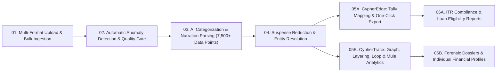
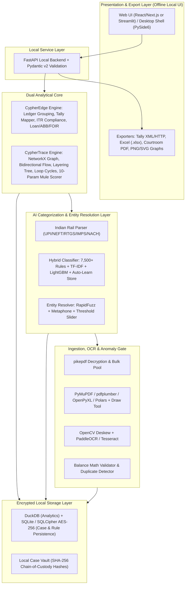

# Software Requirements Specification (SRS) & Python Implementation Architecture
## Unified Bank Statement Analyzer (`CypherEdge`) & Forensic Fund Trail Intelligence Platform (`CypherTrace`)

**Document ID:** `SRS-CYPHER-PY-2026-001`  
**Version:** `1.0.0`  
**Target Implementation Language:** Python 3.11+  
**Deployment Model:** 100% Offline-First Desktop / Air-Gapped On-Premise Server (with Optional Local Web UI)  
**Source References:**
- `CypherEdge Brochure.pdf` (Bank Statement Analyzer for CAs, Tax Professionals, MSMEs & Loan DSAs)
- `CypherSOL Fund trail Analyser.pdf` (`CypherTrace` — AI-Powered Forensic Accounting Intelligence Tool)
- `https://cyphersol.co.in/bank-statement-analyzer/` (CypherSOL Platform Capabilities & Workflows)

---

## Table of Contents

1. [Executive Summary & Product Vision](#1-executive-summary--product-vision)
2. [Target User Personas & Use Cases](#2-target-user-personas--use-cases)
3. [End-to-End 6-Step Functional Workflow](#3-end-to-end-6-step-functional-workflow)
4. [Functional Requirements — Module A: Data Ingestion, Parsing & Normalization (`FR-ING`)](#4-functional-requirements--module-a-data-ingestion-parsing--normalization-fr-ing)
5. [Functional Requirements — Module B: AI Categorization, Suspense Reduction & Entity Resolution (`FR-CAT` & `FR-ENT`)](#5-functional-requirements--module-b-ai-categorization-suspense-reduction--entity-resolution-fr-cat--fr-ent)
6. [Functional Requirements — Module C: `CypherEdge` Accounting, Tally, ITR & Loan Eligibility (`FR-EDGE`)](#6-functional-requirements--module-c-cypheredge-accounting-tally-itr--loan-eligibility-fr-edge)
7. [Functional Requirements — Module D: `CypherTrace` Forensic Intelligence & AML Graph Engine (`FR-TRACE`)](#7-functional-requirements--module-d-cyphertrace-forensic-intelligence--aml-graph-engine-fr-trace)
8. [Recommended Python Technical Stack & System Architecture](#8-recommended-python-technical-stack--system-architecture)
9. [Database & Canonical Data Models (Python `Pydantic` & `SQLAlchemy` Schemas)](#9-database--canonical-data-models-python-pydantic--sqlalchemy-schemas)
10. [Non-Functional Requirements (Security, Performance, Scalability, Compliance)](#10-non-functional-requirements-security-performance-scalability-compliance)
11. [Verification, Testing & Validation Strategy](#11-verification-testing--validation-strategy)
12. [Phased Implementation Roadmap](#12-phased-implementation-roadmap)

---

## 1. Executive Summary & Product Vision

### 1.1 Purpose
This document defines the complete functional, algorithmic, architectural, and non-functional requirements to implement a unified Python-based **Bank Statement Analyzer** and **Forensic Fund Trail Intelligence Platform** modeled on the **CypherSOL** ecosystem (`CypherEdge` and `CypherTrace`).

Financial professionals and law enforcement investigators face a severe operational bottleneck: raw bank statements arrive across hundreds of heterogeneous Indian bank formats (native PDFs, scanned/image PDFs, password-protected PDFs, Excel, CSV, and TXT). Manually extracting, reconciling, categorizing, and tracing multi-account fund flows is slow, error-prone, and misses complex accounting discrepancies or multi-hop money laundering schemes.

### 1.2 Unified Dual-Persona Platform Architecture
The system shall share a common **Core Ingestion, Normalization, Categorization, and Entity Resolution Engine**, branching into two specialized application workspaces:

1. **Module A — `CypherEdge` (Accounting, Tax, & Credit Intelligence):**
   - Purpose-built for Chartered Accountants (CAs), Tax Professionals, MSMEs, Loan Agencies (DSAs), and Financial Institutions.
   - Automates extraction from raw PDF, Excel, and CSV bank statements across **100+ scheduled, private, public, and cooperative Indian banks (105+ statement templates)** into structured, audit-ready Excel workbooks.
   - Classifies transactions using an engine built on **7,500+ curated financial data points** into **51 pre-defined accounting/tax categories** (+1 `Suspense / Uncategorized` fallback = 52 classes).
   - Provides smart ledger grouping, suspense reduction, **ITR-ready compliance reports**, **Loan Eligibility Assessments** (Average Bank Balance, EMI load, bounce tracking, FOIR), and **One-Click Tally XML/HTTP Export** (Payments, Receipts, Contra, Sales, Purchase vouchers).

2. **Module B — `CypherTrace` (Forensic Accounting & AML/CFT Fund Trail Intelligence):**
   - Purpose-built for Central/State Law Enforcement Agencies, Financial Intelligence Units, Vigilance Units, and Forensic Auditors.
   - Handles bulk ingestion of **100+ bank statements simultaneously** across multiple suspects, accounts, and extended timeframes via standardized file naming.
   - Delivers **Network Graph Visualization**, **Bidirectional Flow Analysis**, interactive **Multi-Hop Layering Detection** trees, **Circular Loop Detection** ($A \to B \to C \to A$), **Fuzzy Entity Resolution** with adjustable similarity thresholds, **10-Parameter Mule Account Behavioral Risk Scoring** (`0–100`), and **Individual Financial Profiles** suitable for case briefings and courtroom presentations.
   - Targets a **70%+ reduction** in manual bank statement analysis time.

### 1.3 Core Non-Functional Pillar: 100% Offline-First Execution
Because client tax records and active criminal investigation files are highly sensitive, **all parsing, OCR, ML inference, graph analytics, and database persistence MUST run 100% locally/offline** with zero outbound internet or third-party cloud LLM/API calls during statement processing. The design aligns with **ISO 9001** (Quality Management) and **ISO 27001** (Information Security) principles.

---

## 2. Target User Personas & Use Cases

| Persona Category | Representative Entities / Roles | Primary Inputs | Core Workflows & Analytical Needs | Primary Deliverables / Outputs |
| :--- | :--- | :--- | :--- | :--- |
| **Chartered Accountants (CAs)** | Audit firms, tax practitioners, bookkeeping teams | Client monthly/annual bank PDFs, Excel, CSVs | Automated ledger grouping, suspense resolution, duplicate/anomaly cleanup, Tally posting | Tally XML / direct local HTTP push, reconciled Excel ledgers, audit schedules |
| **Tax Professionals** | ITR consultants, GST practitioners | Full FY (Apr–Mar) personal & business statements | Income/expense categorization, interest/dividend aggregation, Sec 269ST/40A(3)/SFT compliance checks | ITR-ready summary workbooks, AIS/26AS reconciliation sheets |
| **MSMEs & Businesses** | Business owners, finance managers | Multi-bank current/OD/CC statements | Cash-flow visibility, vendor/customer tracking, expense control without extra accounting staff | Monthly cash-flow dashboards, clean Excel books |
| **Loan Agencies (DSAs) & Financial Institutions** | NBFCs, credit underwriters, DSAs | Last 6–12 months borrower statements | Borrower creditworthiness, Average Bank Balance (ABB), existing EMI load, cheque/NACH bounces | Loan Eligibility Assessment PDF/Excel, FOIR & cash-flow scorecard |
| **Central Investigative & Intelligence Agencies** | CBI, ED, SFIO, NIA, DGGI, DRI, FIU-IND, Income Tax Investigation Wing | 100+ seized/subpoenaed suspect & shell company statements | Multi-hop fund trail tracing, layering detection, loop detection, shell/mule scoring, entity consolidation | Courtroom-ready forensic dossiers, interactive layering trees, PDF/Excel evidence packs |
| **State Law Enforcement & Vigilance** | EOW, Cyber Crime Units, ATS, AES, State CID, ACB, Bank Vigilance, RBI, SEBI, IRDAI | Cyber-fraud victim & mule account dumps, regulatory inspection records | Rapid cyber-fraud money trail tracing, fan-in/fan-out identification, cash/crypto leakage analysis | Mule risk rankings (`Critical`/`Suspicious`/`Low`), beneficiary network graphs, Individual Financial Profiles |

---

## 3. End-to-End 6-Step Functional Workflow

Both `CypherEdge` and `CypherTrace` execute a unified 6-step processing pipeline with role-specific branching in Steps 05 and 06:



1. **Step 01 — Upload PDF / Excel / CSV / TXT:** Single or bulk ingestion (100+ files simultaneously) across 100+ Indian banks. Supports native PDFs, scanned/image PDFs (via offline OCR), password-protected PDFs, `.xlsx`, `.xls`, `.csv`, and `.txt`. Includes an interactive **PDF Draw Tool** to manually delineate table/column bounds on non-standard or corrupted PDFs.
2. **Step 02 — Automatic Anomaly Detection:** Pre-analytical validation scans every parsed statement for running-balance math mismatches, duplicate rows, chronological inversions, truncated pages, missing opening/closing balances, and low-confidence OCR cells before categorization begins.
3. **Step 03 — AI-Powered Categorization (7,500+ Data Points):** Parses Indian payment rails (`UPI`, `NEFT`, `RTGS`, `IMPS`, `NACH/ECS`, `AEPS`, `ATM`, `POS`) to extract counterparty names, VPAs, IFSCs, and UTRs, classifying every row into the 52-category taxonomy using deterministic pattern matching + offline ML models.
4. **Step 04 — Suspense Reduction & Entity Resolution:** Presents flagged `Suspense` entries with top-3 AI suggestions, bulk-reassignment, and **auto-learn** persistence. Simultaneously runs **Merge Similar / Entity Resolution** with an adjustable fuzzy similarity slider to consolidate spelling/formatting variations of counterparties into canonical entities.
5. **Step 05 — Operational Export OR Forensic Analytics:**
   - **`CypherEdge` Path:** Maps resolved categories and parties to Tally voucher types (`Payment`, `Receipt`, `Contra`, `Sales`, `Purchase`) and exports via One-Click Tally XML / local Tally HTTP Upload Utility.
   - **`CypherTrace` Path:** Builds the directed transaction multigraph, calculates bidirectional pairwise flows, enables progressive multi-hop Layering Drill-Down (`Move to Misc`), detects temporal circular loops, and computes the 10-parameter Mule Account Risk Score (`0–100`).
6. **Step 06 — Final Reports & Compliance Deliverables:**
   - **`CypherEdge` Path:** Generates audit-ready Excel books, ITR compliance summaries, and Loan Eligibility / Cash-Flow appraisal reports.
   - **`CypherTrace` Path:** Exports Individual Financial Profiles, monthly breakdowns, category distributions, and courtroom-ready visual forensic reports.

---

## 4. Functional Requirements — Module A: Data Ingestion, Parsing & Normalization (`FR-ING`)

### `FR-ING-01`: Multi-Format File Support
The Python ingestion engine shall accept and normalize the following formats:
- **Native Digital PDFs (`.pdf`):** Extract vector text, line geometry, and cell bounding boxes using `PyMuPDF` (`fitz`) and `pdfplumber` (table lattice/stream strategies).
- **Scanned / Image-Based PDFs (`.pdf`):** Automatically detect pages lacking a selectable text layer (`len(text.strip()) < threshold`), render pages at `300 DPI` via `pypdfium2` / `PyMuPDF`, apply `OpenCV` preprocessing (grayscale conversion, adaptive thresholding, deskewing, border/noise removal), and execute offline OCR via `PaddleOCR` (primary) with `Tesseract` (`pytesseract`) fallback.
- **Spreadsheets (`.xlsx`, `.xls`):** Read multi-sheet Excel workbooks via `openpyxl` (`.xlsx`) and `xlrd` (`.xls`), automatically locating the header row by scanning for date/narration/debit/credit/balance header signatures rather than assuming row 1.
- **Delimited Text (`.csv`, `.tsv`, `.txt`):** Detect character encoding (`charset-normalizer` / `chardet`) and delimiter (`,`, `;`, `\t`, `|`, fixed-width spaces) using `csv.Sniffer` + heuristic validation, parsing efficiently with `Polars` / `Pandas`.

### `FR-ING-02`: Password-Protected PDF Decryption
- Support decryption of encrypted Indian bank statements using `pikepdf`.
- Provide both:
  1. Interactive password entry per file or batch password list;
  2. Optional user-supplied metadata pattern generator (e.g., testing common Indian bank password formulas such as `DOB (DDMMYYYY)`, `PAN`, `CustomerID`, or `Last 4 digits of Account + DOB` supplied locally by the analyst).
- Never persist plaintext passwords after decryption unless explicitly permitted in volatile session memory.

### `FR-ING-03`: 100+ Indian Bank Auto-Detection & Template Fingerprinting
- Implement a declarative **Bank Template Registry** (YAML/JSON rules + regex signatures) covering **100+ scheduled, private, public, small finance, payments, and cooperative Indian banks** (including SBI, HDFC, ICICI, Axis, Kotak Mahindra, PNB, Bank of Baroda, Canara Bank, Union Bank of India, Indian Bank, Bank of India, IndusInd, Yes Bank, IDFC First, Federal Bank, RBL, Bandhan, Saraswat, Cosmos, Paytm/Airtel Payments Banks, etc., spanning 105+ distinct layout variations).
- **Fingerprinting Logic:** Match PDF/Excel header metadata (bank name, IFSC prefix, column headers, footer disclaimers) to identify the bank template automatically.
- **Schema Normalization:** Handle all Indian statement column conventions:
  - Split `Withdrawal (Dr)` and `Deposit (Cr)` columns;
  - Single `Amount` column paired with a `Cr/Dr` or `Type` flag column;
  - Signed amount columns (`-1500.00` vs `+1500.00`);
  - Indian numbering format (`12,34,567.89`) and trailing `Cr`/`Dr` suffixes on running balances (`54,321.00 Cr` / `1,200.00 Dr` for OD/CC accounts);
  - Multi-line wrapped transaction narrations (merging continuation lines lacking a leading date into the parent transaction row).
- **Generic Heuristic Fallback Parser:** When an unseen cooperative/regional bank format is encountered, fall back to a column-cluster alignment parser that classifies columns by regex data-type density (date column, numeric currency columns, monotonic balance column, free-text narration column).

### `FR-ING-04`: Interactive PDF Draw Tool (Manual Template Override)
- For malformed, skewed, or unparsed PDFs, the UI/API shall provide a **PDF Draw Tool** allowing the user to render a sample page image, draw an outer table bounding box `[x0, y0, x1, y1]`, and drag vertical column dividers mapping regions to canonical fields: `Txn Date`, `Value Date`, `Narration`, `Cheque/Ref No`, `Debit`, `Credit`, `Balance`.
- The tool shall support saving these user-drawn coordinates as a reusable custom JSON bank template for batch application across remaining pages or sibling statements from the same bank.

### `FR-ING-05`: Bulk Processing & Standardized File Naming
- Support simultaneous upload and parallel processing of **100+ bank statements** via `concurrent.futures.ProcessPoolExecutor`.
- Support standardized forensic file-naming conventions (e.g., `<CaseID>_<EntityName>_<BankCode>_<AccountNo>_<Period>.pdf`) to automatically extract or verify subject identity, bank code, and account number when PDF headers are redacted or degraded.

### `FR-ING-06`: Automatic Anomaly Detection & Data Quality Gate
Before downstream categorization or graph construction, every ingested statement shall pass through an automated anomaly validator that flags and logs:
1. **Running Balance Discontinuity:**
   $$\left| \text{Balance}_t - \left(\text{Balance}_{t-1} + \text{Credit}_t - \text{Debit}_t\right) \right| > \epsilon \quad (\epsilon = 0.05\text{ INR})$$
   Detects missing pages, OCR digit misreads (`8` vs `3`, `0` vs `6`), reversed statement sort order (automatically reversing descending statements to chronological ascending order before checking), or tampered/forged PDF rows.
2. **Duplicate Transaction Detection:** Flags exact duplicates `(date, amount, direction, normalized_narration, balance)` across overlapping statement periods (e.g., Q1 + H1 uploads) and supports one-click deduplication.
3. **Date Sequence & Format Ambiguity Check:** Resolves `DD/MM/YYYY` vs `MM/DD/YYYY` across the full statement window and flags out-of-order dates.
4. **Zero/Negative Amount & Missing Header Alerts:** Flags rows where both `Debit` and `Credit` are `0` or non-null simultaneously, or where account metadata (Account No / IFSC / Period) is missing.
5. **Visual Status Feedback:** Rows are tagged with status indicators (`VALID` [Green], `BALANCE_MISMATCH` [Red], `DUPLICATE_SUSPECT` [Amber], `LOW_OCR_CONFIDENCE` [Yellow]) for analyst review.

---

## 5. Functional Requirements — Module B: AI Categorization, Suspense Reduction & Entity Resolution (`FR-CAT` & `FR-ENT`)

### `FR-CAT-01`: Indian Banking Narration Parser
The NLP/Regex parser shall decompose raw Indian banking narrations into structured attributes:
- **Payment Channel Extraction:** `UPI`, `NEFT`, `RTGS`, `IMPS`, `NACH`/`ACH`/`ECS`, `ATM`, `AEPS`, `POS`/`ECOM`, `CHEQUE`/`CLG`, `INTERNAL_TRANSFER`, `BANK_CHARGE`, `INTEREST`, `CASH_CDM`.
- **Identifier Extraction:**
  - 12-digit / 16-digit / alphanumeric **UTR / RRN / Reference Numbers**;
  - **UPI VPA** (`handle@bank`, e.g., `merchant@okicici`, `9876543210@ybl`);
  - **IFSC Codes** (`^[A-Z]{4}0[A-Z0-9]{6}$`);
  - **Counterparty Account Numbers** (masked or full digits embedded in NEFT/RTGS/IMPS strings);
  - **Cheque Numbers** (6-digit numeric tokens);
  - **Merchant / Counterparty Raw Name** extracted from structured delimiters (`UPI/CR/4123.../NAME/BANK/...`, `NEFT*IFSC*UTR*NAME`, `IMPS-OUT/UTR/NAME/MMID`, `ACH D- INSTITUTION-MANDATE`).

### `FR-CAT-02`: 7,500+ Data Point Hybrid Classification Engine
The categorization engine shall combine deterministic domain intelligence with offline supervised ML:
1. **Tier 1 — Deterministic Knowledge Base (7,500+ Curated Data Points):**
   - Local encrypted/compiled dictionary of **7,500+ Indian banking patterns**, spanning:
     - Major Indian banks, NBFCs, HFCs, and FinTech lenders (Bajaj Finance, HDFC Ltd, Muthoot, Lendingkart, KreditBee, etc.);
     - Payment aggregators & UPI merchant prefixes (Razorpay, Cashfree, PayU, BillDesk, CCAvenue, BharatPe, PhonePe Merchant);
     - Statutory & government portals (CBDT/TIN-NSDL, GSTN, EPFO, ESIC, MCA, MahaGST, Parivahan, Municipal Corporations);
     - Utilities, telecom, SaaS, fuel, e-commerce, food delivery, travel, insurance, mutual fund AMCs/RTAs (CAMS, KFintech, BSE StAR MF), stock brokers (Zerodha, Groww, Upstox, Angel One), and Indian crypto/VDA exchanges (CoinDCX, WazirX, CoinSwitch, ZebPay);
     - Bank-specific fee/charge/bounce/interest strings across 100+ Indian banks.
   - Evaluates exact regex, VPA suffix, IFSC prefix, and narration token rules with direction awareness (`Credit` vs `Debit`).
2. **Tier 2 — Offline Supervised ML Classifier:**
   - Activated when Tier 1 yields no high-priority deterministic match.
   - Feature pipeline: Character n-grams (`3–5`) + Word n-grams (`1–2`) via `TfidfVectorizer`, combined with tabular features (`direction [CR/DR]`, `log1p(amount)`, `is_round_number`, `payment_channel_onehot`, `day_of_month`, `is_recurring_mandate`).
   - Classifier: `LightGBM` (`LGBMClassifier`) or calibrated `SGDClassifier` (`CalibratedClassifierCV`) trained offline on labeled Indian banking narrations, returning class probability vector $P(c_k \mid x)$.
3. **Tier 3 — Confidence Gating & Suspense Routing:**
   - Let $c^* = \arg\max_k P(c_k \mid x)$ and $p^* = \max_k P(c_k \mid x)$.
   - If $p^* < \tau_{\text{cat}}$ (configurable threshold, default $\tau_{\text{cat}} = 0.65$), assign the transaction to Category `52: Suspense / Uncategorized` and store the **Top-3 AI Suggested Categories** with their confidence probabilities for human-in-the-loop resolution.

### `FR-CAT-03`: Standardized 52-Category Taxonomy
To unify `CypherEdge`'s **51 pre-defined operational/accounting categories** and `CypherTrace`'s **52 forensic/analytical categories**, the platform implements **51 pre-defined substantive categories (IDs `01–51`) plus 1 `Suspense / Uncategorized` fallback (`ID 52`)**:

| ID | Category Group | Category Name | Typical Direction | Primary Analytical Relevance (`Edge` / `Trace`) |
| :---: | :--- | :--- | :---: | :--- |
| **01** | Income & Receipts | Salary & Wages Received | CR | Income / ITR / Lifestyle baseline |
| **02** | Income & Receipts | Business Sales & Trade Receipts | CR | Turnover / GST / Sales Voucher |
| **03** | Income & Receipts | Professional & Consultancy Fees | CR | ITR Sec 44ADA / Receipt |
| **04** | Income & Receipts | Interest Income (Savings / FD / Sweep) | CR | ITR Sec 80TTA/80TTB / Other Sources |
| **05** | Income & Receipts | Dividend & Capital Gain Payouts | CR | ITR Capital Gains / Other Sources |
| **06** | Income & Receipts | Rental & Lease Income | CR | ITR Income from House Property |
| **07** | Income & Receipts | Tax Refund (Income Tax / GST) | CR | Statutory Refund Verification |
| **08** | Income & Receipts | Loan / Credit Line Disbursal Received | CR | Debt Inflow / Credit Source Flag |
| **09** | Income & Receipts | Capital / Partner / Director Infusion | CR | Equity / Unsecured Loan Verification |
| **10** | Income & Receipts | Commission, Brokerage & Incentive Income | CR | Business Receipt / TDS Sec 194H |
| **11** | Operating & Business | Vendor & Supplier Payments | DR | Purchase / Sundry Creditors |
| **12** | Operating & Business | Inventory & Raw Material Purchase | DR | COGS / Tally Purchase Voucher |
| **13** | Operating & Business | Office / Commercial Rent & Maintenance | DR | Indirect Expense / TDS Sec 194I |
| **14** | Operating & Business | Employee Payroll, Wages & Stipends | DR | Payroll / Operating Expense |
| **15** | Operating & Business | Electricity, Water & Gas Utilities | DR | Utility / Operating Expense |
| **16** | Operating & Business | Telecom, Broadband & Mobile Bills | DR | Communication Expense |
| **17** | Operating & Business | Software, SaaS & Cloud Subscriptions | DR | IT / Operating Expense |
| **18** | Operating & Business | Legal, Audit & Professional Consultancy Paid | DR | Professional Fees / TDS Sec 194J |
| **19** | Operating & Business | Marketing, Digital Ads & Promotion | DR | Selling & Distribution Expense |
| **20** | Operating & Business | Freight, Logistics, Transport & Courier | DR | Direct/Indirect Logistics Expense |
| **21** | Operating & Business | Printing, Stationery & Office Supplies | DR | Office Admin Expense |
| **22** | Operating & Business | Repairs, AMC & Facility Maintenance | DR | Maintenance Expense |
| **23** | Banking & Debt | Home Loan / Mortgage EMI | DR | FOIR / EMI Load / Sec 24(b) & 80C |
| **24** | Banking & Debt | Vehicle / Auto Loan EMI | DR | FOIR / EMI Load |
| **25** | Banking & Debt | Personal / Business / Unsecured Loan EMI | DR | FOIR / EMI Load / Debt Stress |
| **26** | Banking & Debt | Credit Card Bill Settlement | DR | Credit Utilization / Lifestyle |
| **27** | Banking & Debt | Bank Charges, SMS & Min Balance Penalties | DR | Bank Charges Ledger |
| **28** | Banking & Debt | Cheque / ECS / NACH Bounce & Return Charges | DR | **Critical Credit Red Flag** (Loan Eligibility) |
| **29** | Banking & Debt | OD / CC / Loan Interest & Processing Fees | DR | Finance Cost |
| **30** | Banking & Debt | Forex, Remittance & LRS Charges | DR/CR | Cross-Border / FEMA Flag |
| **31** | Investments & Wealth | Mutual Fund / SIP Investment | DR | Investment Asset / Wealth |
| **32** | Investments & Wealth | Equity / Stock Broker Settlement (Demat) | DR/CR | Capital Market / Trading Flow |
| **33** | Investments & Wealth | Fixed Deposit / RD Creation (Sweep Out) | DR | Contra / Asset Transfer |
| **34** | Investments & Wealth | Fixed Deposit / Investment Maturity Proceeds | CR | Principal + Interest Redemption |
| **35** | Investments & Wealth | Insurance Premium (Life / Health / Motor) | DR | Sec 80C / 80D / Risk Cover |
| **36** | Investments & Wealth | Provident Fund / Retirement (EPF / PPF / NPS) | DR | Sec 80C / 80CCD |
| **37** | Investments & Wealth | Crypto / Virtual Digital Asset (VDA) Exchange | DR/CR | **Mule Leakage & Sec 115BBH Flag** |
| **38** | Taxes & Statutory | Income Tax / Advance Tax / TDS Challan | DR | Direct Tax / Balance Sheet Asset |
| **39** | Taxes & Statutory | GST Payment (PMT-06 / Challan) | DR | Indirect Tax Liability |
| **40** | Taxes & Statutory | Professional Tax / Municipal / Property Tax | DR | Statutory Rates & Taxes |
| **41** | Taxes & Statutory | Customs Duty & Import/Export Levies | DR | Indirect Tax / Trade |
| **42** | Taxes & Statutory | Government Fees, Stamp Duty & Penalties | DR | Regulatory / Non-Deductible Check |
| **43** | Personal & Lifestyle | Food Delivery, Dining & Restaurants | DR | **Mule Lifestyle Signal** |
| **44** | Personal & Lifestyle | Groceries, Kirana & Supermarkets | DR | **Mule Lifestyle Signal** |
| **45** | Personal & Lifestyle | Fuel, EV Charging, Fastag & Local Commute | DR | **Mule Lifestyle Signal** |
| **46** | Personal & Lifestyle | Travel, Airlines, Railways & Hotels | DR | **Mule Lifestyle Signal** |
| **47** | Personal & Lifestyle | Healthcare, Hospitals & Pharmacy | DR | **Mule Lifestyle Signal** / Sec 80D |
| **48** | Personal & Lifestyle | E-Commerce, Apparel & Retail Shopping | DR | **Mule Lifestyle Signal** |
| **49** | Cash, Transfers & Suspense | Self / Inter-Account Contra Transfer | DR/CR | Tally Contra / Exclude from Turnover |
| **50** | Cash, Transfers & Suspense | Cash Deposit (Branch / CDM) | CR | Tally Contra / SFT > ₹10L Flag |
| **51** | Cash, Transfers & Suspense | Cash Withdrawal (ATM / AEPS / Bearer Chq) | DR | **Mule Cash Leakage / Sec 40A(3) Flag** |
| **52** | Cash, Transfers & Suspense | **Suspense / Uncategorized** | DR/CR | Pending User Review / Auto-Learn |

### `FR-CAT-04`: Suspense Reduction & Auto-Learn Engine
- Provide a dedicated **Suspense Reduction Workbench** displaying only `Category 52` transactions grouped by extracted counterparty/narration pattern, along with Top-3 AI suggestions.
- **Auto-Refresh Propagation:** When a user reclassifies a single suspense row (e.g., mapping `NEFT/SHREE BALAJI ENT` to `Vendor & Supplier Payments`), the engine shall offer one-click propagation across all matching transactions in the workspace (`Auto-Refresh`).
- **Local Auto-Learn Loop:** Persist confirmed user corrections `(normalized_pattern, direction, target_category_id, tally_ledger_name)` into a local SQLite/JSON User Rule Store with higher precedence than the base ML classifier, enabling incremental accuracy improvements without external cloud training.

### `FR-ENT-01`: Entity Resolution & Name Merging (`Merge Similar`)
Bank narrations and statement headers frequently split a single person or company across dozens of aliases (e.g., `M/S POOJAN VIG`, `POOJAN VIG`, `Pujan Vij`, `UPI/POOJANVIG@OKHDFC`). The Entity Resolution engine shall:
1. **Text Normalization:** Uppercase conversion, removal of salutations (`MR`, `MRS`, `MS`, `SHRI`, `SMT`, `DR`), legal entity suffixes (`PVT LTD`, `PRIVATE LIMITED`, `LLP`, `INC`, `CO`, `ENTERPRISES`, `TRADERS`, `M/S`), punctuation, and banking stop-words (`IMPS`, `NEFT`, `UPI`, `TRF`, `BY`, `TO`).
2. **Multi-Metric Similarity Scoring:**
   - Lexical fuzzy similarity via `RapidFuzz`: weighted combination of `token_sort_ratio`, `token_set_ratio`, and `Jaro-Winkler` similarity;
   - Phonetic similarity via `jellyfish` (`Metaphone` / `Soundex` adapted for common Indian transliteration pairs like `SH/S`, `PH/F`, `V/W`, `EE/I`, `OO/U`, `MOHD/MOHAMMED`);
   - Exact deterministic identifier linking (shared Account Number, PAN, or primary UPI VPA forces similarity = `1.0`).
3. **Adjustable Similarity Threshold Slider:** Expose a runtime threshold parameter $\theta_{\text{sim}} \in [0.50, 1.00]$ (default `0.85`). Lowering the slider widens merge clusters; raising it enforces stricter matching.
4. **Interactive Cluster Review (`Merge Similar`):** Present candidate alias clusters to the user for bulk confirmation, manual split, or manual merge into a single canonical `EntityID` (`ResolvedEntity`), updating all downstream Tally ledgers, network graphs, layering trees, and loop analyses simultaneously.

---

## 6. Functional Requirements — Module C: `CypherEdge` Accounting, Tally, ITR & Loan Eligibility (`FR-EDGE`)

### `FR-EDGE-01`: Smart Ledger Grouping & Tally Voucher Mapping
- Map each classified transaction to an accounting **Tally Group** and **Voucher Type**:
  - `Category 50` (Cash Deposit), `Category 51` (Cash Withdrawal), and `Category 49` (Self/Inter-Bank Transfer) $\implies$ **`Contra`** voucher (with `Cash` or target `Bank Account` as counterpart ledger).
  - Remaining `Debit (DR)` operational/expense/asset rows $\implies$ **`Payment`** voucher (or **`Purchase`** voucher when mapped to `Category 11/12` vendor trade accounts if configured).
  - Remaining `Credit (CR)` revenue/receipt rows $\implies$ **`Receipt`** voucher (or **`Sales`** voucher when mapped to `Category 02` trade debtors if configured).
- Maintain a configurable **51-Category $\leftrightarrow$ Tally Default Ledger Group Map** (e.g., `Indirect Expenses`, `Direct Expenses`, `Bank Charges`, `Duties & Taxes`, `Loans & Advances (Asset)`, `Secured Loans`, `Unsecured Loans`, `Sundry Creditors`, `Sundry Debtors`, `Fixed Deposits`).
- Allow CAs to override individual counterparty ledger names (e.g., mapping `AIRTEL` $\to$ `Telephone & Internet Expenses` or `Vendor X` $\to$ `X Enterprises Pvt Ltd` under `Sundry Creditors`).

### `FR-EDGE-02`: One-Click Tally Export & Upload Utility
- **Tally XML Generation (`lxml`):** Generate schema-compliant Tally Prime / Tally ERP 9 XML import envelopes containing:
  1. `<TALLYMESSAGE>` `LEDGER` master creation blocks (automatically creating missing party/expense/bank ledgers under their assigned parent groups so Tally import never fails with "Ledger does not exist");
  2. `<TALLYMESSAGE>` `VOUCHER` blocks containing `DATE` (`YYYYMMDD`), `VOUCHERTYPENAME`, `NARRATION`, `VOUCHERNUMBER`, `GUID` (deterministic UUID derived from transaction hash to prevent duplicate re-imports), and balanced double-entry `<ALLLEDGERENTRIES.LIST>` (`ISDEEMEDPOSITIVE` and signed `AMOUNT`).
- **One-Click Direct HTTP Push (Upload Utility):** Post XML payloads directly to a locally running Tally instance via HTTP `POST http://localhost:9000` (configurable host/port), parsing Tally's `<RESPONSE><CREATED>...</CREATED><ERRORS>...</ERRORS></RESPONSE>` XML and presenting a clean import summary.
- **Excel-to-Tally Export:** Export a multi-sheet structured `.xlsx` workbook formatted for standard Tally Excel import utilities and CA audit working papers.

### `FR-EDGE-03`: ITR-Ready Compliance Report Generation
Generate a Financial-Year (`1 April – 31 March`) compliance workbook and summary JSON/PDF containing:
1. **Cash Flow & Income Reconciliation:** Gross Credits vs Excluded Contra/Self-Transfers vs Loan Disbursals vs Net Taxable Business/Professional Receipts.
2. **Interest & Dividend Schedule:** Breakdown of Savings Interest (`Sec 80TTA/80TTB`), FD Interest, and Dividend credits for Schedule OS.
3. **Chapter VI-A Deduction Candidates:** Auto-extracted totals for `ELSS/PPF/LIC/Term Insurance` (`Sec 80C`), `Health Insurance` (`Sec 80D`), `NPS` (`Sec 80CCD`), and `Home Loan Interest/Principal` (`Sec 24b/80C`).
4. **Statutory Tax & SFT/Compliance Red-Flag Scanner:**
   - **Aggregate Cash Deposits > ₹10,00,000** in Savings Accounts (SFT-003 / AIS trigger);
   - **Single/Aggregate Cash Receipts $\ge$ ₹2,00,000** (`Section 269ST` violation check);
   - **Cash Expenditure > ₹10,000 in a single day** to a party (`Section 40A(3)` disallowance warning);
   - **High-Value Investments / Property / Credit Card / VDA Transactions** (`Section 115BBH` crypto flag);
   - **TDS Compliance Candidates:** Payments under `Rent`, `Professional Fees`, `Contractors`, `Commission` exceeding statutory annual thresholds (`Sec 194C/194H/194I/194J`).

### `FR-EDGE-04`: Loan Eligibility & Credit Appraisal Engine (DSA / NBFC Module)
Compute standardized banking credit metrics per account and consolidated across borrower accounts:
1. **Daily & Monthly Average Bank Balance (ABB):**
   - Continuous daily EOD balance average: $\text{ABB}_{\text{daily}} = \frac{1}{D} \sum_{d=1}^{D} B_d$ (carrying forward EOD balance on zero-transaction days);
   - Fixed-date banking ABB (average of closing balances on the `5th, 10th, 15th, 20th, 25th, and Last Day` of each month, standard across Indian NBFC/DSA underwriting).
2. **Existing EMI & Debt Obligation Load:**
   - Detect recurring `NACH/ECS/SI` debits matching loan categories (`23–25`) across consecutive months, reporting lender name, EMI amount, debit date, and monthly total `Existing EMI`.
3. **Bounce & Irregularity Metrics:**
   - **Inward Cheque/NACH Returns (I/W Bounce):** Count and % of attempted debits returned due to insufficient funds (`INSUFF FUNDS`, `ECS RTN`, `NACH RETURN`, `Category 28`).
   - **Outward Cheque Returns (O/W Bounce):** Count of deposited customer cheques dishonored.
   - **Overdraft/Penal Interest Events:** Count of `TOD`, `Excess`, or `Min Balance Penalty` events.
4. **Cash vs Banking Turnover & Net Cash Flow:**
   - Monthly `Total Credits`, `Net Business Credits` (excluding contra/loans/reversals), `Cash Deposit %`, `Cash Withdrawal %`, and `Net Surplus`.
5. **Loan Eligibility Estimator:**
   - Configurable **FOIR** (Fixed Obligation to Income Ratio, e.g., `50%–65%`), assumed interest rate $r$, and tenure $n$ months to compute `Max Eligible Monthly EMI` and indicative `Eligible Loan Principal` via standard annuity formula:
     $$P_{\max} = \text{EMI}_{\text{avail}} \cdot \frac{(1 + i)^n - 1}{i (1 + i)^n}, \quad i = \frac{r}{12 \times 100}$$

---

## 7. Functional Requirements — Module D: `CypherTrace` Forensic Intelligence & AML Graph Engine (`FR-TRACE`)

### `FR-TRACE-01`: Network Graph Visualization
- Construct a directed temporal multigraph $G = (V, E)$ where:
  - Nodes $v \in V$ represent **Resolved Entities** (or individual bank accounts prior to merge), annotated with entity type, total inflow, total outflow, statement availability (`Has Statement` vs `Details Only`), and Mule Risk Tier.
  - Directed edges $e = (u \to v)$ represent aggregated or individual fund flows carrying `total_amount`, `tx_count`, `first_tx_date`, `last_tx_date`, and `tx_ids`.
- **Colour-Coding & Visual Cues:**
  - Color-code nodes by role/status (`Credit Source`, `Has Statement`, `Details Only`, or by `Mule Risk Tier`: Critical Red / Suspicious Amber / Low Risk Green) and edge thickness scaled logarithmically by transfer volume ($\log_{10}(\text{amount})$).
- **Structural Centrality Analytics:** Compute **In-Degree**, **Out-Degree**, **Betweenness Centrality** (exposing hidden common intermediaries/bridge mules), **PageRank**, and **Connected Components** (`NetworkX`) to surface hidden links between disparate suspects.
- **Interactive Filtering:** Filter graph edges/nodes dynamically by date range, minimum transfer amount, payment channel (`UPI`, `NEFT`, `RTGS`, `IMPS`), geographic location/IFSC branch, and keyword search.

### `FR-TRACE-02`: Bidirectional Flow Analysis
For any pair of subjects $(A, B)$ selected from the network or entity list, compute and display:
- **Directional Aggregates:**
  - $\text{Total Flow}_{A \to B} = \sum_{e \in E(A \to B)} \text{amount}(e)$ and transaction count $N_{A \to B}$;
  - $\text{Total Flow}_{B \to A} = \sum_{e \in E(B \to A)} \text{amount}(e)$ and transaction count $N_{B \to A}$;
  - **Net Flow:** $\text{Net Flow}_{A,B} = \text{Total Flow}_{A \to B} - \text{Total Flow}_{B \to A}$.
- **Timing & Cadence Metrics:**
  - Minimum, median, and maximum turnaround time ($\Delta t$) between an $A \to B$ transfer and subsequent reciprocal $B \to A$ transfer;
  - Flag **Rapid Round-Tripping** when reciprocal flows settle within a configurable threshold (e.g., $\Delta t \le 48\text{ hours}$) with similar amounts (indicative of accommodation entries / bogus billing / layering).
- **Chronological Dual-Ledger View:** Side-by-side timeline of all $(A \to B)$ and $(B \to A)$ transactions with UTRs, dates, narrations, and cumulative net balance curve.

### `FR-TRACE-03`: Layering Detection & Interactive Drill-Down Tree
Replicate and implement the progressive multi-hop money-flow tracing engine shown in the `CypherTrace` Layering view:
1. **Algorithmic Fund Attribution (Progressive Hop Tracing):**
   - Investigator selects a root **Credit Source** entity or specific credit transaction $(u_0 \to v_1, t_0, \text{amt}_0)$.
   - For any node $v_k$ at depth $k$ that **has an uploaded statement** (`has_statement == True`), the engine queries all outgoing debits from $v_k$ occurring within $[t_{\text{in}}, t_{\text{in}} + \Delta t_{\text{layer}}]$ (configurable window, e.g., `24h`, `72h`, `7 days`, `30 days`).
   - Supports two attribution modes:
     - **Chronological FIFO Exhaustion:** Traces outgoing debits sequentially starting immediately after $t_{\text{in}}$ until cumulative traced outflow reaches $\text{amt}_{\text{in}}$ (or window ends);
     - **All-Outflows-in-Window Mode:** Displays all downstream recipients within $\Delta t_{\text{layer}}$ ranked by amount spent.
2. **Exact Node & UI Specification (per `CypherTrace` Screenshot):**
   - **Header Legend & Counter Bar:** Displays color legend (`Blue: Credit Source`, `Green: Has Statement`, `Grey: Details Only`) and total visible entity count badge (`N entities`).
   - **Root Node (`Credit Source` — Blue Card):** Displays icon, Entity Name (e.g., `AYAZ QURESHI`), `Total Amount: ₹X`, and action link `Click to view details`, connected downward via labeled edge `Money Flow`.
   - **Downstream Nodes with Statements (`✓ Has Statement` — Green Card):** Displays person/entity icon, Entity Name, status sub-label `✓ Has Statement`, `Amount Spent: ₹Y`, `Click to drill deeper` (clicking dynamically expands Level $k+1$ downstream outgoing transfers in the tree), and an action button **`Move to Misc`**.
   - **Downstream Nodes without Statements (`Details Only` — Grey Card):** Displays counterparty extracted solely from narration (`has_statement == False`), entity name, `Details Only`, `Amount Spent: ₹Z`, and **`Move to Misc`** action.
   - **`Move to Misc` Decluttering Action:** Allows investigators to collapse benign or irrelevant child branches (e.g., routine utility/merchant spends) into a single aggregated **`Miscellaneous`** node at that tree level without deleting underlying data, keeping courtroom diagrams clean and focused on suspect trails. Reversible via `Restore from Misc`.

### `FR-TRACE-04`: Loop Detection (Circular Transaction Analysis)
Automatically detect and visualize circular money laundering loops ($A \to B \to C \to \dots \to A$) across the case graph:
1. **Temporal Cycle Detection Algorithm:**
   - First extract candidate simple cycles in the directed entity graph $G$ using Johnson's algorithm (`networkx.simple_cycles`, capped at configurable `max_cycle_length`, default `2 to 8` hops).
   - Validate **Temporal Causality** on each candidate cycle $(v_1 \to v_2 \to \dots \to v_m \to v_1)$ by searching for a sequence of concrete transactions $(e_1, e_2, \dots, e_m)$ satisfying:
     - **Monotonic Time Ordering:** $t(e_1) \le t(e_2) \le \dots \le t(e_m)$
     - **Cycle Time Window Constraint:** $t(e_m) - t(e_1) \le T_{\max}$ (configurable: `24h`, `72h`, `7d`, `30d`, or custom days)
     - **Amount Retention Ratio:** $\frac{\min_j \text{amt}(e_j)}{\max_j \text{amt}(e_j)} \ge \rho_{\min}$ (configurable tolerance, default $\rho_{\min} = 0.50$, accounting for commission/cut deductions at each hop)
2. **Circular Diagram Visualization & Output:**
   - Render each verified loop as an interactive **Circular Flow Diagram** showing every node along the ring, directed arc labels with `₹ Amount`, `Date/Timestamp`, `Channel/UTR`, total loop duration, value retention %, and net leakage/commission retained per intermediary.

### `FR-TRACE-05`: Mule Account Detection (10-Parameter Behavioral Scoring Engine)
Every bank account with an uploaded statement shall be evaluated across **10 weighted behavioral parameters**, each normalized to $S_k \in [0, 1]$, producing a deterministic composite **Mule Risk Score** $\in [0, 100]$:

$$\text{Mule Risk Score} = 100 \times \sum_{k=1}^{10} w_k \cdot S_k, \quad \sum_{k=1}^{10} w_k = 1.00$$

| # | Parameter Name | Weight ($w_k$) | Mathematical Definition & Scoring Logic ($S_k \in [0, 1]$) |
| :-: | :--- | :---: | :--- |
| **1** | **Flow-Through Ratio** | **25%** (`0.25`) | Measures whether incoming funds immediately equal outgoing funds (`Money In` ≈ `Money Out`):<br>$S_1 = 1 - \frac{\left|\sum \text{CR} - \sum \text{DR}\right|}{\max\left(\sum \text{CR}, \sum \text{DR}\right)}$ when $\max(\sum \text{CR}, \sum \text{DR}) > 0$, else $0$.<br>Gated by minimum turnover threshold (default ≥ ₹50,000) to avoid penalizing inactive low-balance accounts. |
| **2** | **Velocity of Funds (Hold Time)** | **20%** (`0.20`) | Computes FIFO-matched hold duration $\Delta t_i = t_{\text{debit}, i} - t_{\text{credit}, i}$ (in hours, or same-day order index when time-of-day is absent in PDFs). Let $\tilde{\Delta t}$ be the amount-weighted median hold time:<br>$S_2 = \exp\left(-\frac{\tilde{\Delta t}}{H_0}\right)$<br>where half-life $H_0 = 12\text{ hours}$ (or $0.5\text{ days}$ when timestamps are date-only). Immediate minute/same-day pass-through yields $S_2 \to 1.0$. |
| **3** | **Lifestyle Spending Absence** | **15%** (`0.15`) | Evaluates lack of organic day-to-day living expenses (Categories `43–48`: Food, Groceries, Fuel, Travel, Healthcare, Retail, plus `15–16` Utilities/Telecom). Let $r_{\text{life}} = \frac{\text{Count(Lifestyle Txns)}}{\text{Active Months}}$:<br>$S_3 = 1 - \min\left(1,\; \frac{r_{\text{life}}}{L_{\text{expected}}}\right)$<br>with default $L_{\text{expected}} = 6\text{ txns/month}$. Zero lifestyle activity on a high-turnover account yields $S_3 = 1.0$. |
| **4** | **Counterparty Concentration** | **10%** (`0.10`) | Measures concentration using the normalized **Herfindahl-Hirschman Index (HHI)** across counterparty transfer volumes $p_i = \frac{\text{Vol}_i}{\sum_j \text{Vol}_j}$:<br>$S_4 = \sum_{i=1}^{M} p_i^2$<br>Restricted/closed-group trading among a few entities yields $S_4 \to 1.0$. |
| **5** | **Fan-In / Fan-Out Topology** | **10%** (`0.10`) | Detects asymmetric collector (`many-in, few-out`) or distributor (`few-in, many-out`) patterns within sliding 24h windows. Let $d_{\text{in}}$ = unique senders and $d_{\text{out}}$ = unique receivers in peak window:<br>$S_5 = \max\left(\min\left(1, \frac{d_{\text{in}}}{10}\right)\cdot \left(1 - \min\left(0.8, \frac{d_{\text{out}}}{d_{\text{in}} + 1}\right)\right),\; \min\left(1, \frac{d_{\text{out}}}{10}\right)\cdot \left(1 - \min\left(0.8, \frac{d_{\text{in}}}{d_{\text{out}} + 1}\right)\right)\right)$ |
| **6** | **Cash / Crypto / Wallet Leakage** | **5%** (`0.05`) | Share of total debit volume exiting the formal banking trail via Cash Withdrawals (ATM / AEPS / Bearer Chq, `Category 51`), VDA/Crypto Exchanges (`Category 37`), or digital wallet load-outs:<br>$S_6 = \min\left(1,\; \frac{\sum \text{Cash/AEPS/Crypto/Wallet Debits}}{\sum \text{Total Debits}}\right)$ |
| **7** | **Structuring / Smurfing Detection** | **5%** (`0.05`) | Fraction of transactions falling immediately below Indian statutory/CTR/PAN reporting thresholds (`₹45,000–₹49,999`, `₹1,80,000–₹1,99,999`, `₹9,00,000–₹9,99,999`), or repeated same-day split transfers summing above threshold:<br>$S_7 = \min\left(1,\; 3 \times \frac{\text{Count(Near-Threshold Txns)}}{\text{Total Txns}}\right)$ |
| **8** | **Zero Balance Oscillation** | **5%** (`0.05`) | Fraction of active days/cycles where EOD balance drops below floor $\delta_{\text{zero}} = \max(500,\; 0.01 \times \text{Peak Credit})$ INR immediately after large inflows (> ₹10,000):<br>$S_8 = \frac{\text{Count(Post-Debit Balance} \le \delta_{\text{zero}} \text{ after inflow} > 10000\text{)}}{\text{Count(Inflows} > 10000\text{)}}$ |
| **9** | **Burst / Dormancy Pattern** | **3%** (`0.03`) | Identifies dormant accounts suddenly spiking in volume after a dormancy gap ≥ 30 days. Let $\mu_{\text{base}}$ be median monthly turnover prior to peak month and $\text{Vol}_{\text{peak}}$ be peak 7-day/30-day turnover:<br>$S_9 = 1 - \exp\left(-\frac{\text{Vol}_{\text{peak}}}{\max(\mu_{\text{base}}, 10000) \times 5}\right)$ when dormancy ≥ 30 days exists, else $0$. |
| **10** | **Round Number Anomalies** | **2%** (`0.02`) | Proportion of non-cash/non-ATM electronic transfers (`NEFT/RTGS/IMPS/UPI`) that are exact multiples of ₹5,000 or ₹10,000 (indicative of scripted/manual laundering splits):<br>$S_{10} = \frac{\text{Count(Electronic Txns} \bmod 5000 == 0\text{)}}{\text{Count(Electronic Txns)}}$ |

#### Risk Score Tiers & Explainability
- **Critical Risk (`80 – 100`):** High-confidence mule/conduit account; highlight in **Red** with exact triggered parameter breakdown.
- **Suspicious (`50 – 79`):** Requires manual investigator scrutiny; highlight in **Amber/Orange**.
- **Low Risk (`0 – 49`):** Normal organic banking profile; highlight in **Green**.
- Every score MUST expose a transparent **Explainability Vector** listing all 10 raw parameter metrics, normalized scores $S_k$, weighted contributions $w_k \cdot S_k \cdot 100$, and direct links to supporting evidence transactions.

### `FR-TRACE-06`: Individual Financial Profiles & Exportable Reports
- Auto-generate a comprehensive **Individual Financial Profile** per resolved entity/account containing:
  - Executive KPI cards (Opening/Closing Balance, Total Credits, Total Debits, Net Flow, Mule Score & Tier, Active Accounts);
  - Monthly credit/debit/ABB breakdown table & trend chart;
  - Category-wise spend & receipt distribution across the 52 categories;
  - Payment channel mix (`UPI`, `NEFT`, `RTGS`, `IMPS`, `Cash`, `Cheque`);
  - Top 15 Inflow Senders & Top 15 Outflow Beneficiaries;
  - Exportable **Courtroom-Ready PDF Dossier** (`WeasyPrint`/`ReportLab`), interactive HTML graph snapshot, and multi-sheet **Excel Audit Workbook** (`XlsxWriter`).

---

## 8. Recommended Python Technical Stack & System Architecture

### 8.1 High-Level Modular System Architecture



### 8.2 Concrete Python Package Matrix

| Layer | Capability | Recommended Python Libraries | Rationale |
| :--- | :--- | :--- | :--- |
| **PDF & OCR Ingestion** | Native PDF table/text extraction | `PyMuPDF` (`fitz`), `pdfplumber`, `pypdfium2` | High-speed C-backed PDF rendering + precise table cell coordinate extraction |
| **PDF Decryption** | Encrypted bank statements | `pikepdf` | Robust QPDF bindings for password unlocking |
| **Offline OCR** | Scanned/image PDF statements | `paddleocr`, `pytesseract`, `opencv-python-headless`, `Pillow` | Accurate table/digit OCR with OpenCV deskewing & binarization |
| **Tabular & Bulk Processing** | Excel/CSV/TXT parsing & parallel ingestion | `polars`, `pandas`, `openpyxl`, `xlrd`, `charset-normalizer` | Vectorized multi-threaded processing for 100k+ transactions in seconds |
| **NLP & Categorization** | 7,500+ patterns + offline ML | `scikit-learn`, `lightgbm`, `joblib`, `regex` | Low-latency offline inference with calibrated probability outputs |
| **Entity Resolution** | Fuzzy & phonetic name matching | `rapidfuzz`, `jellyfish` | C++ accelerated Levenshtein/Jaro-Winkler + Metaphone/Soundex |
| **Graph & Forensic Engine** | Network, layering, cycle detection | `networkx`, `scipy`, `numpy` | Proven `simple_cycles`, centrality, and temporal flow algorithms |
| **Storage & Security** | Encrypted persistence & analytical SQL | `duckdb`, `sqlalchemy`, `sqlcipher3` / `pysqlcipher3`, `cryptography` | Sub-second OLAP aggregations + AES-256 encryption at rest |
| **API & UI** | Local REST/WebSocket + Interactive UI | `fastapi`, `uvicorn`, `pydantic>=2.0`, `streamlit` or React + `Cytoscape.js` | Clean separation between Python engine and interactive graph/draw-tool UI |
| **Exports & Reporting** | Tally XML, Excel, PDF dossiers | `lxml`, `httpx` (local Tally port), `xlsxwriter`, `weasyprint` / `reportlab`, `matplotlib` | Schema-valid Tally XML, formatted multi-tab Excel, courtroom-grade PDFs |
| **Testing & Packaging** | Automated QA & offline installer | `pytest`, `hypothesis`, `pyinstaller` / `briefcase` | Property-based math invariants + single-click offline installer |

### 8.3 Proposed Python Repository Directory Layout

```text
cyphersol_engine/
├── pyproject.toml
├── README.md
├── data/
│   ├── bank_templates/          # 105+ YAML/JSON Indian bank layout & regex profiles
│   ├── knowledge_base/          # 7,500+ curated Indian merchant/IFSC/VPA/tax rules
│   ├── taxonomy_52.json         # Canonical 51+1 category definitions & Tally mappings
│   └── models/                  # Pre-trained offline LightGBM & TF-IDF artifacts (.joblib)
├── src/
│   └── cyphersol/
│       ├── config.py            # Offline paths, thresholds, logging, security settings
│       ├── models/              # Pydantic v2 domain schemas & SQLAlchemy ORM models
│       ├── ingestion/
│       │   ├── decryptor.py     # pikepdf password handling
│       │   ├── pdf_parser.py    # PyMuPDF / pdfplumber / Draw-Tool coordinate extractor
│       │   ├── ocr_engine.py    # OpenCV preprocessing + PaddleOCR/Tesseract fallback
│       │   ├── tabular_parser.py# Excel/CSV/TXT normalizer
│       │   ├── bank_detector.py # 100+ Indian bank template matcher
│       │   ├── bulk_runner.py   # ProcessPoolExecutor & standardized filename parser
│       │   └── anomaly_gate.py  # Running balance equation, duplicates, OCR flags
│       ├── nlp/
│       │   ├── narration_parser.py  # UPI/NEFT/RTGS/IMPS/NACH/AEPS extractor
│       │   ├── categorizer.py       # Tier 1 rules + Tier 2 LightGBM + Tier 3 Suspense
│       │   ├── auto_learn.py        # User override rule persistence & propagation
│       │   └── entity_resolver.py   # RapidFuzz + Metaphone clustering & Merge Similar
│       ├── edge/                    # CypherEdge Module
│       │   ├── ledger_mapper.py     # Voucher type & Tally group resolver
│       │   ├── tally_exporter.py    # Tally XML builder & HTTP localhost:9000 utility
│       │   ├── itr_compliance.py    # FY summaries, Sec 269ST/40A(3)/SFT/80C checks
│       │   └── loan_eligibility.py  # ABB, EMI load, bounce stats, FOIR estimator
│       ├── trace/                   # CypherTrace Module
│       │   ├── graph_builder.py     # NetworkX temporal multigraph & centrality
│       │   ├── bidirectional.py     # Pairwise A<->B flow & net balance metrics
│       │   ├── layering_tree.py     # Progressive FIFO/window drill-down & Move to Misc
│       │   ├── loop_detector.py     # Temporal Johnson's simple_cycles detector
│       │   ├── mule_scorer.py       # 10-parameter weighted risk model (0-100)
│       │   └── financial_profile.py # Individual entity profile compiler
│       ├── reporting/
│       │   ├── excel_writer.py      # Audit-ready multi-sheet Excel workbooks
│       │   ├── pdf_dossier.py       # Courtroom forensic PDF & Loan reports
│       │   └── evidence_cert.py     # SHA-256 chain-of-custody & Sec 63 BSA metadata
│       └── api/
│           ├── main.py              # FastAPI app & local CORS/auth middleware
│           └── routes/              # Ingestion, Workbench, Edge, Trace, Export routers
└── tests/
    ├── unit/
    ├── property/                # Hypothesis balance & graph conservation tests
    └── fixtures/                # Synthetic & anonymized Indian bank statements
```

---

## 9. Database & Canonical Data Models (Python `Pydantic` & `SQLAlchemy` Schemas)

All ingestion, categorization, accounting, and forensic modules shall exchange strongly typed `Pydantic v2` models backed by persistent SQLite/DuckDB tables:

```python
from datetime import datetime, date
from decimal import Decimal
from enum import Enum
from typing import Dict, List, Optional
from uuid import UUID
from pydantic import BaseModel, Field


class WorkspaceMode(str, Enum):
    CYPHER_EDGE = "cypher_edge"
    CYPHER_TRACE = "cypher_trace"


class TxDirection(str, Enum):
    CREDIT = "CR"
    DEBIT = "DR"


class AnomalyFlag(str, Enum):
    VALID = "VALID"
    BALANCE_MISMATCH = "BALANCE_MISMATCH"
    DUPLICATE_SUSPECT = "DUPLICATE_SUSPECT"
    DATE_OUT_OF_ORDER = "DATE_OUT_OF_ORDER"
    LOW_OCR_CONFIDENCE = "LOW_OCR_CONFIDENCE"
    MISSING_METADATA = "MISSING_METADATA"


class VoucherType(str, Enum):
    PAYMENT = "Payment"
    RECEIPT = "Receipt"
    CONTRA = "Contra"
    SALES = "Sales"
    PURCHASE = "Purchase"
    JOURNAL = "Journal"


class MuleRiskTier(str, Enum):
    CRITICAL = "Critical"      # 80 - 100
    SUSPICIOUS = "Suspicious"  # 50 - 79
    LOW_RISK = "Low Risk"      # 0 - 49


class InvestigationCase(BaseModel):
    case_id: UUID
    title: str
    mode: WorkspaceMode
    agency_or_firm_name: Optional[str] = None
    created_at: datetime
    similarity_threshold: float = Field(default=0.85, ge=0.50, le=1.00)
    confidence_threshold: float = Field(default=0.65, ge=0.0, le=1.0)


class BankAccountStatement(BaseModel):
    statement_id: UUID
    case_id: UUID
    source_filename: str
    sha256_hash: str
    bank_code: str
    bank_name: str
    account_number: str
    ifsc_code: Optional[str] = None
    account_holder_name: str
    account_type: Optional[str] = None  # Savings, Current, OD, CC
    period_start: date
    period_end: date
    opening_balance: Decimal
    closing_balance: Decimal
    total_transactions: int
    balance_mismatch_count: int = 0
    is_ocr_derived: bool = False


class NormalizedTransaction(BaseModel):
    tx_id: UUID
    statement_id: UUID
    case_id: UUID
    row_index: int
    txn_date: date
    txn_timestamp: Optional[datetime] = None
    value_date: Optional[date] = None
    raw_narration: str
    cheque_or_ref_no: Optional[str] = None
    utr_number: Optional[str] = None
    payment_channel: str  # UPI, NEFT, RTGS, IMPS, NACH, ATM, AEPS, POS, CHQ, etc.
    direction: TxDirection
    debit: Decimal = Field(default=Decimal("0.00"), ge=0)
    credit: Decimal = Field(default=Decimal("0.00"), ge=0)
    running_balance: Decimal
    extracted_counterparty: Optional[str] = None
    counterparty_vpa_or_acc: Optional[str] = None
    counterparty_ifsc: Optional[str] = None
    resolved_entity_id: Optional[UUID] = None
    category_id: int = Field(ge=1, le=52)
    category_name: str
    categorization_source: str  # USER_RULE, RULE_KB_7500, ML_MODEL, SUSPENSE
    confidence_score: float = Field(ge=0.0, le=1.0)
    top3_suggestions: List[Dict[str, float]] = Field(default_factory=list)
    is_suspense: bool = False
    tally_voucher_type: Optional[VoucherType] = None
    tally_ledger_name: Optional[str] = None
    anomaly_flags: List[AnomalyFlag] = Field(default_factory=list)
    is_duplicate_ignored: bool = False


class ResolvedEntity(BaseModel):
    entity_id: UUID
    case_id: UUID
    canonical_name: str
    aliases: List[str] = Field(default_factory=list)
    linked_account_numbers: List[str] = Field(default_factory=list)
    linked_vpas: List[str] = Field(default_factory=list)
    has_statement: bool = False  # True -> Green 'Has Statement'; False -> Grey 'Details Only'
    is_moved_to_misc: bool = False
    total_credited: Decimal = Decimal("0.00")
    total_debited: Decimal = Decimal("0.00")


class MuleParameterBreakdown(BaseModel):
    flow_through_ratio: float = Field(ge=0.0, le=1.0)          # 25%
    velocity_hold_time: float = Field(ge=0.0, le=1.0)          # 20%
    lifestyle_spending_absence: float = Field(ge=0.0, le=1.0)  # 15%
    counterparty_concentration: float = Field(ge=0.0, le=1.0)  # 10%
    fan_in_fan_out_pattern: float = Field(ge=0.0, le=1.0)      # 10%
    cash_crypto_wallet_leakage: float = Field(ge=0.0, le=1.0)  # 5%
    structuring_smurfing: float = Field(ge=0.0, le=1.0)        # 5%
    zero_balance_oscillation: float = Field(ge=0.0, le=1.0)    # 5%
    burst_dormancy_pattern: float = Field(ge=0.0, le=1.0)      # 3%
    round_number_anomalies: float = Field(ge=0.0, le=1.0)      # 2%


class MuleRiskAssessment(BaseModel):
    account_number: str
    entity_id: Optional[UUID] = None
    composite_score: float = Field(ge=0.0, le=100.0)
    risk_tier: MuleRiskTier
    parameters: MuleParameterBreakdown
    median_hold_hours: Optional[float] = None
    cash_crypto_leakage_pct: float = 0.0
    lifestyle_txn_count: int = 0
    flagged_evidence_tx_ids: List[UUID] = Field(default_factory=list)
```

---

## 10. Non-Functional Requirements (Security, Performance, Scalability, Compliance)

### `NFR-SEC-01`: Offline-First & Zero Telemetry Execution
- Application binaries, ML models, OCR weights, and the 7,500+ data-point knowledge base must be bundled locally so the entire platform runs in air-gapped law enforcement networks and CA offices without external internet calls.

### `NFR-SEC-02`: ISO 27001 Data Protection & Forensic Chain of Custody
- **Encryption at Rest:** Encrypt case databases using **AES-256** (`SQLCipher`) and encrypt temporary extracted artifacts on disk with machine/user-derived keys (`cryptography.fernet` / `AESGCM`), wiping temp files securely upon case closure.
- **Forensic Integrity (Section 63 BSA / Section 65B Indian Evidence Act Readiness):** Compute and store immutable `SHA-256` hashes for every uploaded source bank statement PDF/Excel/CSV at ingestion time, along with ingestion timestamp, parser version, and analyst identity, enabling generation of digital evidence integrity metadata certificates.
- **Immutable Audit Trail:** Log all analyst actions (statement upload, Draw Tool override, `Suspense` reassignment, `Merge Similar` entity changes, `Move to Misc` toggles, report exports) in an append-only audit log table.
- **Role-Based Access Control (RBAC):** Optional local operator login (`Case Lead / Investigator`, `Analyst / Junior CA`, `Reviewer / Auditor`) for multi-user on-premise deployments.

### `NFR-PERF-01`: Performance & Scalability Targets
- **Bulk Ingestion Speed:** Process **100+ native PDF/Excel statements (`100,000+` total transactions)** within **`< 60 seconds`** on an 8-core / 16 GB RAM workstation using multi-process PDF parsing and vectorized `Polars`/`DuckDB` pipelines.
- **Interactive UI Latency:** Graph filtering, Layering node drill-down, Bidirectional flow queries, and Entity threshold slider re-clustering shall respond within **`< 500 ms`** for up to `50,000` edges.
- **Productivity Benchmark:** Deliver at least a **70% reduction in manual analysis time** compared to spreadsheet-based manual reconciliation and tracing.

### `NFR-REL-01`: Accuracy & Reliability Benchmarks
- **Extraction Recall & Precision:** $\ge 99\%$ row extraction accuracy on native digital PDFs/Excels across the 100+ supported Indian bank templates; zero silent row drops (enforced by the Step 02 running-balance equation check).
- **Categorization Accuracy:** $\ge 92\%$ Macro-F1 across active categories on Indian banking benchmarks, with uncertain rows safely routed to `Suspense` rather than misclassified silently.

---

## 11. Verification, Testing & Validation Strategy

1. **Unit Testing (`pytest`):**
   - Parser unit tests against anonymized fixtures from top Indian banks (SBI, HDFC, ICICI, Axis, Kotak, PNB, BoB, Canara, Union, IDFC First, Cooperative banks) covering single-column `Dr/Cr`, split `Debit/Credit`, multi-line wrapped narrations, and OD/CC `Dr` balances.
   - Indian rail narration tests (`UPI`, `NEFT`, `RTGS`, `IMPS`, `NACH`, `AEPS`, `ATM`).
   - Mule scorer unit tests verifying boundary conditions for all 10 parameters (`0.0` vs `1.0`) and exact weighted sum (`Critical >= 80`, `Suspicious 50–79`, `Low Risk < 50`).
2. **Property-Based Testing (`hypothesis`):**
   - Generate synthetic transaction sequences with arbitrary splits, round-trips, and loops to verify mathematical invariants:
     - Running balance conservation across chronological sorting;
     - Bidirectional flow antisymmetry ($\text{NetFlow}_{A,B} = -\text{NetFlow}_{B,A}$);
     - Layering tree outflow attribution never exceeds source credit amount in FIFO mode;
     - Mule composite score strictly remains within $[0.0, 100.0]$.
3. **Integration & End-to-End Pipeline Tests:**
   - Bulk ingest 100 synthetic multi-suspect statements containing embedded 3-hop and 4-hop circular loops ($A \to B \to C \to A$), a known fan-in/fan-out mule account, and lifestyle-spending control accounts; assert 100% detection recall on planted loops and mule tier classification.
   - Validate generated Tally XML output against Tally Prime XML schema structure and test round-trip parsing of all generated `.xlsx` and `.pdf` reports.

---

## 12. Phased Implementation Roadmap

| Phase | Scope & Deliverables | Exit Criteria |
| :--- | :--- | :--- |
| **Phase 1: Core Ingestion, OCR & Anomaly Gate** | Multi-format ingestion (`PyMuPDF`, `pdfplumber`, `OpenCV` + `PaddleOCR`, `openpyxl`, `Polars`), `pikepdf` decryption, initial 40+ top Indian bank YAML templates, interactive PDF Draw Tool, bulk runner (`ProcessPoolExecutor`), SHA-256 hashing, and Step 02 Running-Balance Anomaly Gate. | `100%` balance math reconciliation on test suite; 100 statements ingested in `< 60s`. |
| **Phase 2: AI Categorizer, Suspense & Entity Resolution** | Indian rail narration parser, 7,500+ data-point rule base, offline `LightGBM` model for 51+1 categories, Suspense Workbench with Auto-Learn rule persistence, and `RapidFuzz` + `Metaphone` Entity Resolution (`Merge Similar` threshold slider). | Macro-F1 $\ge 92\%$ on labeled validation dataset; end-to-end auto-learn persistence verified. |
| **Phase 3: `CypherEdge` Accounting & Credit Suite** | Remaining bank templates (100+ banks / 105+ formats), Smart Tally Ledger/Voucher mapping, Tally XML builder + `localhost:9000` Upload Utility, ITR-Ready Compliance Report (`Sec 269ST/40A(3)/SFT/80C`), and Loan Eligibility Engine (`ABB`, `EMI Load`, `Bounces`, `FOIR`). | Valid Tally Prime import verified; CA audit Excel & Loan DSA reports exported cleanly. |
| **Phase 4: `CypherTrace` Forensic Graph & Mule Engine** | `NetworkX` temporal multigraph UI, Bidirectional Flow Analyzer, Layering Drill-Down Tree (`Credit Source` / `Has Statement` / `Details Only` / `Move to Misc`), Temporal Loop Detector, 10-Parameter Mule Scorer (`0–100`), and Individual Financial Profile PDF Dossiers. | Planted multi-hop loops, layering trails, and Critical (`80–100`) mules accurately isolated and exported. |
| **Phase 5: Security Hardening & Offline Packaging** | `SQLCipher` AES-256 encryption, RBAC, immutable audit logs, Section 63 BSA evidence hash certificate, performance tuning, and standalone offline packaging (`PyInstaller`/`Briefcase`) for Windows/macOS/Linux air-gapped environments. | Offline installer runs with zero network access; passes full QA & security checklist. |
