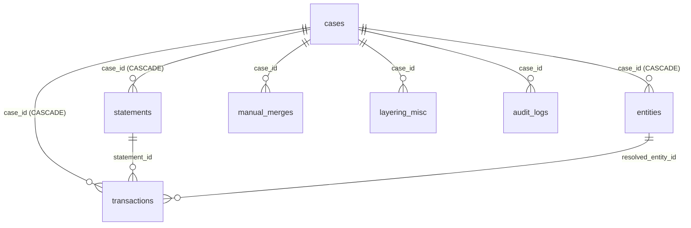

# CypherSOL Data & Variable Dictionary

**Audience:** Backend & Frontend Engineers, Data Engineers, QA Automation Engineers, Security Auditors  
**Scope:** Canonical domain models, enumerations, SQLite schema & indexes, module constants, algorithmic thresholds, regexes, environment variables, REST API contracts, and frontend UI state across **CypherSOL v1.0.0** (`CypherEdge` + `CypherTrace`).

---

## Table of Contents

1. [Global Data Conventions & Invariants](#1-global-data-conventions--invariants)
2. [Enumerations & Controlled Vocabularies](#2-enumerations--controlled-vocabularies)
3. [Domain & Engine Dataclasses Reference](#3-domain--engine-dataclasses-reference)
4. [SQLite Vault Relational Schema & Index Dictionary](#4-sqlite-vault-relational-schema--index-dictionary)
5. [Module Constants, Thresholds, Regexes & Environment Variables](#5-module-constants-thresholds-regexes--environment-variables)
6. [REST API Request / Response Contract Dictionary](#6-rest-api-request--response-contract-dictionary)
7. [Frontend UI State & Rendering Constants (`ui/app.js`)](#7-frontend-ui-state--rendering-constants-uiappjs)

---

## 1. Global Data Conventions & Invariants

| Concern | Python Representation | SQLite Storage | JSON / API Wire Format | Notes & Precision Rules |
| :--- | :--- | :--- | :--- | :--- |
| **Monetary Amounts** | `decimal.Decimal` (`quantize(Decimal("0.01"))`) or `float` (analytics) | `REAL` | `number` (`round(val, 2)`) | All ingested `debit`, `credit`, `running_balance`, `opening_balance`, and `closing_balance` values are parsed into `Decimal` to 2 decimal places (`models.serialize_value`). |
| **Calendar Dates** | `str` (`YYYY-MM-DD`) | `TEXT` | `string` (`YYYY-MM-DD`) | Normalized via `ingestion.parser.parse_indian_date()` across `18` Indian banking date formats (`_DATE_FORMATS`). |
| **Timestamps** | `str` (`YYYY-MM-DDTHH:MM:SS`) | `TEXT` | `string` (`ISO-8601`) | Statement transactions default time component to `T12:00:00` when no `HH:MM` is present (`parse_timestamp()`). Audit/creation timestamps use UTC ISO-8601 (`dt.timezone.utc`). |
| **Primary Identifiers** | `str` | `TEXT PRIMARY KEY` | `string` | `statement_id` and `tx_id` use random `uuid.uuid4()`; deterministic IDs (`entity_id`, `rule_id`, `loop_id`, Tally `guid`) use `uuid.uuid5()`. Case IDs use `CASE_<10 HEX>`. Draw templates use `TPL_<8 HEX>`. |
| **Evidence Integrity** | `sha256_hash: str` | `TEXT NOT NULL` | `string` (`64` lowercase hex) | Computed over raw uploaded file bytes (`hashlib.sha256(file_bytes).hexdigest()`) prior to decoding/parsing for Section 63 BSA admissibility. |
| **JSON Serialization** | `models.serialize_value(val)` | JSON columns (`*_json`) | Standard JSON objects/arrays | Converts `Enum` $\to$ `.value`, `Decimal` $\to$ `float(round(val, 2))`, `date`/`datetime` $\to$ `.isoformat()`, and dataclasses recursively via `asdict`. |

---

## 2. Enumerations & Controlled Vocabularies

### 2.1 Core `Enum` Types (`src/cyphersol/models.py`)

| Enum Class | Member Name | String Value | Used In | Semantics |
| :--- | :--- | :--- | :--- | :--- |
| `WorkspaceMode` | `CYPHER_EDGE` | `"cypher_edge"` | `cases.mode` | CA / Tax Compliance / Loan DSA default landing focus |
| `WorkspaceMode` | `CYPHER_TRACE` | `"cypher_trace"` | `cases.mode` | Forensic / Law Enforcement / AML Investigation focus |
| `TxDirection` | `CREDIT` | `"CR"` | `transactions.direction`, `user_rules.direction` | Money inflow into account (`credit > 0`) |
| `TxDirection` | `DEBIT` | `"DR"` | `transactions.direction`, `user_rules.direction` | Money outflow from account (`debit > 0`) |
| `AnomalyFlag` | `VALID` | `"VALID"` | `transactions.anomaly_flags_json` | Passed all Step 02 quality checks |
| `AnomalyFlag` | `BALANCE_MISMATCH` | `"BALANCE_MISMATCH"` | `transactions.anomaly_flags_json` | $\lvert \text{Bal}_t - (\text{Bal}_{t-1} + \text{Cr}_t - \text{Dr}_t) \rvert > 0.05$ |
| `AnomalyFlag` | `DUPLICATE_SUSPECT` | `"DUPLICATE_SUSPECT"` | `transactions.anomaly_flags_json` | Identical `(account_no, txn_date, debit, credit, running_balance)` signature already seen in statement or case |
| `AnomalyFlag` | `DATE_OUT_OF_ORDER` | `"DATE_OUT_OF_ORDER"` | `transactions.anomaly_flags_json` | Chronological date inversion (`txn_date[i] < txn_date[i-1]`) after descending-order normalization |
| `AnomalyFlag` | `LOW_OCR_CONFIDENCE` | `"LOW_OCR_CONFIDENCE"` | `transactions.anomaly_flags_json` | Derived from an image/OCR-flagged PDF (`statement.is_ocr_derived = True`) |
| `AnomalyFlag` | `MISSING_METADATA` | `"MISSING_METADATA"` | `transactions.anomaly_flags_json` | Account number is `"UNKNOWN_AC"` or `raw_narration` is blank |
| `VoucherType` | `PAYMENT` | `"Payment"` | `transactions.tally_voucher_type`, `CategorySpec` | Outward Tally payment voucher |
| `VoucherType` | `RECEIPT` | `"Receipt"` | `transactions.tally_voucher_type`, `CategorySpec` | Inward Tally receipt voucher |
| `VoucherType` | `CONTRA` | `"Contra"` | `transactions.tally_voucher_type`, `CategorySpec` | Bank/Cash self-transfer (`Cat 33, 49, 50, 51`) |
| `VoucherType` | `SALES` | `"Sales"` | `VoucherType` | Supported Tally sales voucher constant |
| `VoucherType` | `PURCHASE` | `"Purchase"` | `VoucherType` | Supported Tally purchase voucher constant |
| `VoucherType` | `JOURNAL` | `"Journal"` | `transactions.tally_voucher_type`, `CategorySpec` | Uncategorized / adjustment voucher (`Cat 52`) |
| `MuleRiskTier` | `CRITICAL` | `"Critical"` | `MuleRiskAssessment.risk_tier` | Composite Mule Score in `[80.0, 100.0]` |
| `MuleRiskTier` | `SUSPICIOUS` | `"Suspicious"` | `MuleRiskAssessment.risk_tier` | Composite Mule Score in `[50.0, 79.99]` |
| `MuleRiskTier` | `LOW_RISK` | `"Low Risk"` | `MuleRiskAssessment.risk_tier` | Composite Mule Score in `[0.0, 49.99]` |

### 2.2 Controlled String Vocabularies

| Vocabulary | Allowed String Tokens | Origin Function / File |
| :--- | :--- | :--- |
| **`payment_channel`** | `"AEPS"`, `"UPI"`, `"RTGS"`, `"NEFT"`, `"IMPS"`, `"NACH"`, `"ATM"`, `"CASH_CDM"`, `"CASH_WDL"`, `"POS"`, `"CHEQUE"`, `"INTEREST"`, `"CHARGES"`, `"FOREX"`, `"TRANSFER"`, `"OTHER"` | `nlp.narration_parser.detect_channel()` (default before enrichment: `"OTHER"`) |
| **`categorization_source`** | `"PENDING"`, `"USER_RULE"`, `"RULE_KB_7500"`, `"ML_MODEL"`, `"SUSPENSE"`, `"LLM_AGENT_STAGE4"` | `nlp.categorizer.HybridTransactionCategorizer`, `llm_agents.Stage4CategorizationEntityAgent` |
| **`execution_mode`** | `"heuristics"`, `"both"`, `"llm"` | `llm_agents.VALID_EXECUTION_MODES` (`"heuristics"` = 100% offline; `"both"` = hybrid backup; `"llm"` = LLM primary) |
| **`llm_provider`** | `"gemini"`, `"claude"`, `"openai"` | `llm_agents.VALID_PROVIDERS` |
| **`typical_direction`** (`CategorySpec`) | `"CR"`, `"DR"`, `"BOTH"` | `taxonomy.CATEGORIES_52` |
| **Layering Node `role`** (`LayeringNode`) | `"CREDIT_SOURCE"`, `"HAS_STATEMENT"`, `"DETAILS_ONLY"`, `"MISC"` | `trace.layering.build_layering_tree()` |
| **Graph `node_role`** (`build_network_graph`) | `"PRIMARY_HUB"` (`"Primary Account Hub"`), `"BRIDGE_CONDUIT"` (`"Bridge / Conduit"`), `"EXIT_ENDPOINT"` (`"Cash / VDA Exit"`), `"PERIPHERAL_LEAF"` (`"Peripheral Counterparty"`) | `trace.graph_engine.build_network_graph()` |
| **ITR Red Flag `severity`** | `"CRITICAL"`, `"HIGH"`, `"MEDIUM"` | `edge.itr_compliance.generate_itr_compliance_report()` |
| **Loan `credit_grade`** | `"PRIME (A)"`, `"STANDARD (B)"`, `"HIGH RISK / REFER (C)"`, `"INSUFFICIENT_DATA"` | `edge.loan_eligibility.compute_loan_eligibility_report()` |

---

## 3. Domain & Engine Dataclasses Reference

### 3.1 `InvestigationCase` (`src/cyphersol/models.py`)

| Field | Type | Default | Constraint / Range | Description |
| :--- | :--- | :--- | :--- | :--- |
| `case_id` | `str` | *Required* | `CASE_<10 HEX>` or preset demo ID | Unique workspace primary key |
| `title` | `str` | *Required* | Non-empty trimmed string | Investigation / CA client display title |
| `mode` | `WorkspaceMode` | *Required* | Enum (`cypher_edge` / `cypher_trace`) | Primary operating mode selector |
| `created_at` | `str` | *Required* | UTC ISO-8601 | Creation timestamp |
| `agency_or_firm_name` | `Optional[str]` | `None` | Free text | Law enforcement unit or CA firm printed on PDF/HTML dossiers |
| `similarity_threshold` | `float` | `0.85` | Clamped to `[0.50, 1.00]` in service | Cosine/Jaro-Winkler/phonetic cutoff for Entity Resolution |
| `confidence_threshold` | `float` | `0.65` | `[0.0, 1.0]` | Minimum Naive Bayes posterior required to avoid Suspense (`Cat 52`) |

### 3.2 `BankAccountStatement` (`src/cyphersol/models.py`)

| Field | Type | Default | Constraint / Range | Description |
| :--- | :--- | :--- | :--- | :--- |
| `statement_id` | `str` | *Required* | UUIDv4 string | Unique ingested file identifier |
| `case_id` | `str` | *Required* | FK $\to$ `cases.case_id` | Owning case ID |
| `source_filename` | `str` | *Required* | Basename of uploaded file | Original filename for provenance |
| `sha256_hash` | `str` | *Required* | 64 hex chars | Immutable SHA-256 digest of raw file bytes |
| `bank_code` | `str` | *Required* | Code in `taxonomy.BANK_BY_CODE` | Matched Indian bank short code (fallback: `"SBI"`) |
| `bank_name` | `str` | *Required* | String | Full bank name from `BankProfile` |
| `account_number` | `str` | *Required* | Masked/raw string or `"UNKNOWN_AC"` | Account number from header regex or standardized filename |
| `account_holder_name` | `str` | *Required* | String | Customer name from header regex or filename hint |
| `period_start` | `str` | *Required* | `YYYY-MM-DD` | Minimum `txn_date` in statement |
| `period_end` | `str` | *Required* | `YYYY-MM-DD` | Maximum `txn_date` in statement |
| `opening_balance` | `Decimal` | *Required* | 2 decimal places | Derived as `first.running_balance - first.credit + first.debit` |
| `closing_balance` | `Decimal` | *Required* | 2 decimal places | `last.running_balance` |
| `total_transactions` | `int` | *Required* | $\ge 0$ | Row count normalized after header detection & Anomaly Gate |
| `ifsc_code` | `Optional[str]` | `None` | `[A-Z]{4}0[A-Z0-9]{6}` | Detected or synthetic bank-prefix IFSC |
| `account_type` | `Optional[str]` | `"Savings"` | `"Savings"` or `"Current/OD"` | Inferred from header/filename keywords |
| `balance_mismatch_count` | `int` | `0` | $\ge 0$ | Count of `BALANCE_MISMATCH` transactions in statement |
| `duplicate_suspect_count` | `int` | `0` | $\ge 0$ | Count of `DUPLICATE_SUSPECT` transactions in statement |
| `is_ocr_derived` | `bool` | `False` | Boolean | `True` when PDF contained image streams without extractable text tokens |
| `ingested_at` | `str` | `""` | UTC ISO-8601 | Ingestion timestamp |

### 3.3 `NormalizedTransaction` (`src/cyphersol/models.py`)

| Field | Type | Default | Constraint / Range | Description |
| :--- | :--- | :--- | :--- | :--- |
| `tx_id` | `str` | *Required* | UUIDv4 string | Unique transaction identifier |
| `statement_id` | `str` | *Required* | Statement UUID | Source statement reference |
| `case_id` | `str` | *Required* | FK $\to$ `cases.case_id` | Owning case ID |
| `row_index` | `int` | *Required* | $0 \dots N-1$ | Chronologically normalized sequence index within statement |
| `txn_date` | `str` | *Required* | `YYYY-MM-DD` | Normalized transaction date |
| `raw_narration` | `str` | *Required* | String (multi-line merged) | Full unedited bank statement narration text |
| `payment_channel` | `str` | *Required* | Controlled channel code | Rail detected by `detect_channel()` |
| `direction` | `TxDirection` | *Required* | `"CR"` or `"DR"` | `"CR"` if `credit > 0 and debit == 0` else `"DR"` |
| `debit` | `Decimal` | *Required* | $\ge 0.00$, 2 decimal places | Debit withdrawal amount |
| `credit` | `Decimal` | *Required* | $\ge 0.00$, 2 decimal places | Credit deposit amount |
| `running_balance` | `Decimal` | *Required* | 2 decimal places (negative if `DR` bal) | Post-transaction balance |
| `category_id` | `int` | *Required* | `1..52` | Assigned CypherSOL category ID (`52` = Suspense) |
| `category_name` | `str` | *Required* | String from `CATEGORIES_52` | Human-readable category name |
| `categorization_source` | `str` | *Required* | Source token | Which pipeline tier classified the row |
| `confidence_score` | `float` | *Required* | `[0.0, 1.0]` | Classifier confidence (`1.0` for user resolution, `0.99` user rule) |
| `txn_timestamp` | `Optional[str]` | `None` | `YYYY-MM-DDTHH:MM:SS` | Exact timestamp or `T12:00:00` fallback |
| `value_date` | `Optional[str]` | `None` | `YYYY-MM-DD` | Bank value date or `txn_date` fallback |
| `cheque_or_ref_no` | `Optional[str]` | `None` | String | Extracted Chq/Ref column value |
| `utr_number` | `Optional[str]` | `None` | `[A-Z]{4}[A-Z0-9]{10,18}` or `12..16` digits | Extracted UTR/RRN identifier |
| `extracted_counterparty` | `Optional[str]` | `None` | Uppercase cleaned name ($\ge 2$ chars) | Extracted counterparty name after noise stripping |
| `counterparty_vpa_or_acc` | `Optional[str]` | `None` | VPA (`a@bank`) or masked/full account | Extracted destination/source identifier |
| `counterparty_ifsc` | `Optional[str]` | `None` | `[A-Z]{4}0[A-Z0-9]{6}` | Counterparty IFSC code if present in narration |
| `resolved_entity_id` | `Optional[str]` | `None` | `entities.entity_id` | Clustered counterparty entity ID |
| `top3_suggestions` | `List[Dict[str, Any]]` | `[]` | List of `{category_id, category_name, confidence}` | Top 3 ML/Rule candidate suggestions for Workbench UI |
| `is_suspense` | `bool` | `False` | Boolean | `True` when `category_id == 52` or confidence $< 0.65$ |
| `tally_voucher_type` | `Optional[VoucherType]` | `None` | `VoucherType` enum | Target Tally voucher type |
| `tally_ledger_name` | `Optional[str]` | `None` | String ($\le 64$ chars in XML) | Mapped Tally counterparty/expense ledger |
| `anomaly_flags` | `List[AnomalyFlag]` | `[]` | List of `AnomalyFlag` enums | Output of Step 02 Anomaly Gate |
| `is_duplicate_ignored` | `bool` | `False` | Boolean | When `True`, excluded from totals, Tally, ITR, Loan, Graph & Mule engines |
| `source_account_number` | `Optional[str]` | `None` | String | Denormalized statement account number |
| `source_holder_name` | `Optional[str]` | `None` | String | Denormalized statement holder name |

### 3.4 `ResolvedEntity` (`src/cyphersol/models.py`)

| Field | Type | Default | Constraint / Range | Description |
| :--- | :--- | :--- | :--- | :--- |
| `entity_id` | `str` | *Required* | `uuid.uuid5(NAMESPACE_DNS, f"{case_id}:{canonical_name}")` | Deterministic entity cluster ID within case |
| `case_id` | `str` | *Required* | FK $\to$ `cases.case_id` | Owning case ID |
| `canonical_name` | `str` | *Required* | Longest holder alias (or longest member alias) | Cluster display name (or `UNRESOLVED_<CATEGORY>`) |
| `aliases` | `List[str]` | `[]` | Sorted distinct uppercase aliases | All raw names merged into this cluster |
| `linked_account_numbers` | `List[str]` | `[]` | Sorted distinct account numbers | Statement & narration account numbers linked to entity |
| `linked_vpas` | `List[str]` | `[]` | Sorted distinct lowercase UPI handles | UPI VPAs linked to any alias in cluster |
| `has_statement` | `bool` | `False` | Boolean | `True` if at least one uploaded bank statement belongs to this entity |
| `is_moved_to_misc` | `bool` | `False` | Boolean | Persisted flag (runtime state also stored in `layering_misc`) |
| `total_credited` | `Decimal` | `Decimal("0.00")` | Sum of `tx.credit` across linked transactions | Total credits attributed to entity's transactions |
| `total_debited` | `Decimal` | `Decimal("0.00")` | Sum of `tx.debit` across linked transactions | Total debits attributed to entity's transactions |
| `tx_count` | `int` | `0` | $\ge 0$ | Number of transactions resolved to `entity_id` |

### 3.5 Forensic Traceability & Mule Dataclasses (`src/cyphersol/models.py`)

#### `MuleParameterBreakdown` (all normalized sub-scores in `[0.0, 1.0]`)

| Field | Weight | Formula Summary |
| :--- | :--- | :--- |
| `flow_through_ratio` | `25%` (`0.25`) | $(1 - \frac{\lvert \text{Cr} - \text{Dr} \rvert}{\max(\text{Cr}, \text{Dr})}) \cdot \min(1, \frac{\max(\text{Cr}, \text{Dr})}{50000})$ |
| `velocity_hold_time` | `20%` (`0.20`) | $\exp(-\text{median\_hold\_hours} / 12.0)$ via FIFO credit-lot matching |
| `lifestyle_spending_absence` | `15%` (`0.15`) | $\max(0, 1 - \min(1, (\text{lifestyle\_txns} / \text{active\_months}) / 6.0))$ |
| `counterparty_concentration` | `10%` (`0.10`) | Herfindahl–Hirschman Index $\sum_k (v_k / \sum v)^2$ |
| `fan_in_fan_out_pattern` | `10%` (`0.10`) | Max sliding 24h fan-in / fan-out asymmetry across unique senders & receivers |
| `cash_crypto_wallet_leakage` | `5%` (`0.05`) | Ratio of ATM/AEPS/Cash/VDA/Wallet debit volume to `total_dr` |
| `structuring_smurfing` | `5%` (`0.05`) | $\min(1, 3 \cdot \frac{\text{near\_threshold\_txns}}{\text{total\_txns}})$ for bands `45k–49,999`, `180k–199,999`, `900k–999,999` |
| `zero_balance_oscillation` | `5%` (`0.05`) | Ratio of post-inflow drops to `<= max(500, 0.01 * peak_cr)` over large inflows (`> 10,000`) |
| `burst_dormancy_pattern` | `3%` (`0.03`) | Active only if max gap $\ge 30$ days: $1 - \exp(-\text{peak\_mo\_vol} / (5 \cdot \max(\text{base\_vol}, 10000)))$ |
| `round_number_anomalies` | `2%` (`0.02`) | Fraction of electronic txns with amount $\ge 5,000$ and divisible by `5,000` |

#### `MuleRiskAssessment`, `DrawTemplate`, `BidirectionalFlowResult`, `LayeringNode`, `CircularLoop`

| Class | Key Fields & Types |
| :--- | :--- |
| **`MuleRiskAssessment`** | `account_number: str`, `account_holder_name: str`, `bank_name: str`, `composite_score: float` (`0..100`), `risk_tier: MuleRiskTier`, `parameters: MuleParameterBreakdown`, `entity_id: Optional[str]`, `total_credited: float`, `total_debited: float`, `tx_count: int`, `median_hold_hours: Optional[float]`, `cash_crypto_leakage_pct: float`, `lifestyle_txn_count: int`, `weighted_contributions: Dict[str, float]`, `flagged_evidence_tx_ids: List[str]` (capped at 50) |
| **`DrawTemplate`** | `template_id: str` (`TPL_<8 HEX>`), `bank_code: str`, `template_name: str`, `table_bbox: List[float]` (`[x0, y0, x1, y1]` normalized `0..1` or PDF pt), `column_splits: List[float]` (normalized vertical dividers), `column_names: List[str]`, `created_at: str` |
| **`BidirectionalFlowResult`** | `entity_a_id: str`, `entity_a_name: str`, `entity_b_id: str`, `entity_b_name: str`, `total_a_to_b: float`, `total_b_to_a: float`, `net_flow: float` (`A->B minus B->A`), `tx_count_a_to_b: int`, `tx_count_b_to_a: int`, `min_turnaround_hours: Optional[float]`, `median_turnaround_hours: Optional[float]`, `rapid_round_trip_count: int`, `transactions: List[Dict[str, Any]]` |
| **`LayeringNode`** | `node_id: str` (`L{depth}_{id[:8]}`), `entity_id: str`, `entity_name: str`, `role: str`, `amount: float`, `depth: int`, `has_statement: bool`, `is_misc: bool`, `misc_count: int`, `tx_ids: List[str]`, `children: List[LayeringNode]` |
| **`CircularLoop`** | `loop_id: str` (UUIDv5 of `tx_ids`), `hop_count: int`, `entities: List[str]` (`A -> ... -> A`), `entity_ids: List[str]`, `min_amount: float`, `max_amount: float`, `retention_ratio: float` (`min / max`), `duration_hours: float`, `start_date: str`, `end_date: str`, `hops: List[Dict[str, Any]]` |

### 3.6 LLM & Stage Agent Dataclasses (`src/cyphersol/llm_agents.py`)

| Class | Field | Type | Default | Description |
| :--- | :--- | :--- | :--- | :--- |
| **`LLMConfig`** | `execution_mode` | `str` | `"both"` | Active mode (`"heuristics"`, `"both"`, `"llm"`) |
| | `provider` | `str` | `"gemini"` | Active provider (`"gemini"`, `"claude"`, `"openai"`) |
| | `model` | `str` | `"gemini-2.5-flash"` | Active text/tabular completion model |
| | `vision_model` | `str` | `"gemini-2.5-flash"` | Active multimodal vision model |
| | `api_key` | `str` | `""` | Active provider API key (masked in public exports) |
| | `api_keys` | `Dict[str, str]` | `{}` | Per-provider API keys dictionary |
| | `enable_stage1_vision` | `bool` | `True` | Stage 1 Vision extraction agent toggle |
| | `enable_stage2_reconciliation` | `bool` | `True` | Stage 2 Reconciliation & metadata agent toggle |
| | `enable_stage3_narration` | `bool` | `True` | Stage 3 Narration rail & counterparty agent toggle |
| | `enable_stage4_categorization` | `bool` | `True` | Stage 4 52-category & entity resolution agent toggle |
| | `timeout_sec` | `int` | `45` | Outbound HTTP timeout seconds |
| | `configured` | `bool` | `False` | True if explicitly set via deployment wizard or UI |
| **`StageAgentTelemetry`** | `execution_mode` | `str` | *Required* | Mode under which ingestion/run executed |
| | `provider` | `str` | *Required* | Provider invoked |
| | `model` | `str` | *Required* | Text model used |
| | `vision_model` | `str` | *Required* | Vision model used |
| | `api_key_configured` | `bool` | *Required* | Boolean indicating valid key presence |
| | `stages_invoked` | `List[int]` | `[]` | List of stage numbers invoked (`[1, 2, 3, 4]`) |
| | `stage_details` | `Dict[str, Any]` | `{}` | Per-stage row counts, repairs, and enrichments |
| | `warnings` | `List[str]` | `[]` | Agent fallback notices or error warnings |
| | `timestamp` | `str` | UTC ISO-8601 | Run timestamp |

### 3.7 Internal Helper Dataclasses

| Module | Class | Fields & Purpose |
| :--- | :--- | :--- |
| `cyphersol.taxonomy` | `CategorySpec` (`frozen=True`) | `category_id: int`, `group: str`, `name: str`, `typical_direction: str`, `tally_voucher: VoucherType`, `tally_parent_group: str`, `is_lifestyle: bool`, `is_cash_crypto_leakage: bool`, `itr_section: str` |
| `cyphersol.taxonomy` | `BankProfile` (`frozen=True`) | `bank_code: str`, `bank_name: str`, `ifsc_prefix: str`, `keywords: Tuple[str, ...]` |
| `cyphersol.nlp.narration_parser` | `ParsedNarration` | `payment_channel: str`, `utr_number: Optional[str]`, `counterparty_name: Optional[str]`, `counterparty_vpa_or_acc: Optional[str]`, `counterparty_ifsc: Optional[str]`, `remarks: Optional[str]`, `matched_grammar: Optional[str]` |
| `cyphersol.trace.graph_engine` | `DirectedTransferEvent` | `event_id: str`, `tx_id: str`, `src_entity_id: str`, `src_name: str`, `dst_entity_id: str`, `dst_name: str`, `amount: float`, `txn_date: str`, `txn_timestamp: str`, `channel: str`, `utr_number: Optional[str]`, `narration: str`, `category_id: int` |
| `cyphersol.ingestion.pdf_parser` | `PdfTextToken` | `page: int`, `x: float`, `y: float`, `text: str`, `x_end: float` |
| `cyphersol.ingestion.pdf_parser` | `PdfExtractionResult` | `pages_text: List[str]`, `page_sizes: List[Tuple[float, float]]`, `tokens: List[PdfTextToken]`, `rows: List[List[str]]`, `is_encrypted: bool`, `needs_ocr: bool`, `ocr_engine: Optional[str]` |
| `cyphersol.ingestion.ocr_engine` | `OcrWordToken` | `page: int`, `x: float`, `y: float`, `text: str`, `x_end: float` |

---

## 4. SQLite Vault Relational Schema & Index Dictionary

Managed by `CypherVault` (`src/cyphersol/storage.py`). Every connection configures:
- `PRAGMA journal_mode=WAL;`
- `PRAGMA synchronous=NORMAL;`
- `PRAGMA busy_timeout=5000;`
- `PRAGMA temp_store=MEMORY;`
- `PRAGMA foreign_keys=ON;`

### 4.1 Table Definitions (`10` Tables)

| Table | Primary Key | Foreign Keys / Unique Constraints | Purpose |
| :--- | :--- | :--- | :--- |
| **`cases`** | `case_id TEXT` | `—` | Case/client workspace configuration & NLP/ER thresholds |
| **`statements`** | `statement_id TEXT` | `FK(case_id) REFERENCES cases(case_id) ON DELETE CASCADE` | Uploaded file provenance, bank metadata, SHA-256 digest & anomaly totals |
| **`transactions`** | `tx_id TEXT` | `FK(case_id) REFERENCES cases(case_id) ON DELETE CASCADE` | Normalized transaction ledger across all uploaded statements |
| **`entities`** | `entity_id TEXT` | `FK(case_id) REFERENCES cases(case_id) ON DELETE CASCADE` | Consolidated entity clusters (`aliases_json`, `linked_accounts_json`, `linked_vpas_json`) |
| **`user_rules`** | `rule_id TEXT` | `UNIQUE(pattern, direction)` | Global Auto-Learn rules saved when analysts resolve Suspense transactions |
| **`manual_merges`** | `(case_id, alias_name)` | Scoped per case | Explicit analyst alias-to-canonical entity overrides |
| **`layering_misc`** | `(case_id, entity_id)` | Scoped per case | Entities toggled into the collapsed `Misc` node inside the Layering Tree |
| **`draw_templates`** | `template_id TEXT` | Global reusable templates | Saved PDF bounding-box & column split templates |
| **`audit_logs`** | `log_id TEXT` | Scoped by `case_id` | Immutable operator action trail (`CREATE_CASE`, `INGEST_STATEMENTS`, `RESOLVE_SUSPENSE`, etc.) |
| **`llm_settings`** | `setting_key TEXT` | Global key-value store | Stores runtime `llm_config` (masked in API), per-case telemetry (`case_telemetry:{id}`), and encrypted/hashed key vaults |

### 4.2 JSON Column Schemas & SQLite Indexes

| Column (`Table.Column`) | Embedded JSON Shape |
| :--- | :--- |
| `transactions.top3_suggestions_json` | `[{"category_id": int, "category_name": str, "confidence": float}, ...]` |
| `transactions.anomaly_flags_json` | `["VALID" \| "BALANCE_MISMATCH" \| "DUPLICATE_SUSPECT" \| ...]` |
| `entities.aliases_json` | `["UPPERCASE ALIAS 1", "UPPERCASE ALIAS 2", ...]` |
| `entities.linked_accounts_json` | `["ACCOUNT_NO_1", ...]` |
| `entities.linked_vpas_json` | `["vpa@bank", ...]` |
| `draw_templates.table_bbox_json` | `[x0, y0, x1, y1]` (4 floats) |
| `draw_templates.column_splits_json` | `[s1, s2, ...]` (list of floats) |
| `draw_templates.column_names_json` | `["date", "narration", "ref", "debit", "credit", "balance"]` |
| `audit_logs.details_json` | Arbitrary action metadata dict |

**Registered Indexes (`8` Total):**
- `idx_tx_case` ON `transactions(case_id)`
- `idx_tx_stmt` ON `transactions(statement_id)`
- `idx_stmt_case` ON `statements(case_id)`
- `idx_tx_case_date` ON `transactions(case_id, txn_date, row_index)`
- `idx_tx_entity` ON `transactions(case_id, resolved_entity_id)`
- `idx_tx_category` ON `transactions(case_id, category_id)`
- `idx_ent_case` ON `entities(case_id)`
- `idx_audit_case` ON `audit_logs(case_id, created_at)`

---

## 5. Module Constants, Thresholds, Regexes & Environment Variables

### 5.1 Runtime, CLI & Server Configuration (`run_app.py`, `cli.py`, `server.py`)

| Symbol / Env Var | Value / Default | Location | Purpose |
| :--- | :--- | :--- | :--- |
| `ROOT_DIR` / `SRC_DIR` | Repo root & `<root>/src` | `run_app.py` | Prepended to `sys.path` before importing `cyphersol` |
| `CYPHERSOL_SKIP_VENV_REEXEC` | Env flag (`"1"` disables) | `run_app.py` | Prevents recursive re-exec after switching interpreter into `.venv` |
| `CYPHERSOL_LOG_LEVEL` | `"INFO"` (choices: `DEBUG`, `INFO`, `WARNING`, `ERROR`) | `cli.py` | Default `--log-level` when CLI flag is omitted |
| `sys.dont_write_bytecode` | `True` | `run_app.py` | Suppresses `.pyc` / `__pycache__` generation on disk |
| `--host` / `--port` | `"127.0.0.1"` / `8080` (auto-fallback `8081..8090`) | `cli.py` | HTTP server bind host and port |
| `--db` / `--samples` | `"data/cyphersol_vault.db"` / `"sample_statements"` | `cli.py` | SQLite WAL file path and demo statement folder |
| `MAX_REQUEST_BODY_BYTES` | `157286400` (`150 MiB`) | `server.py` | Enforces `413 Payload Too Large` cap on POST payloads |

### 5.2 Ingestion, Anomaly Gate & Taxonomy Constants

| Symbol | Value / Pattern | Location | Purpose |
| :--- | :--- | :--- | :--- |
| `_IMAGE_EXTENSIONS` | `.bmp`, `.jpeg`, `.jpg`, `.pgm`, `.png`, `.ppm`, `.tif`, `.tiff` | `ingestion/parser.py` | Direct image statement formats routed to `ocr_image_bytes()` |
| `_DATE_FORMATS` | `18` Indian/ISO formats (`%Y-%m-%d`, `%d/%m/%Y`, `%d-%m-%Y`, `%d.%m.%Y`, `%d-%b-%Y`, `%d %B %Y`, etc.) | `ingestion/parser.py` | Sequential date format parser |
| `_HEADER_SYNONYMS` | `9` canonical keys (`value_date`, `date`, `narration`, `ref`, `type`, `debit`, `credit`, `amount`, `balance`) | `ingestion/parser.py` | Ordered word-boundary column header matching (`_header_matches()`) |
| `_FOOTER_LINE_RE` | Line-anchored `page N`, opening/closing/total balance, and statement trailer patterns | `ingestion/parser.py` | Skips page footers without truncating business names such as `"PAGE INDUSTRIES LTD"` |
| `_HEADER_KEYWORDS` | `22` PDF header tokens (`date`, `txn`, `narration`, ..., `balance`) | `ingestion/pdf_parser.py` | Infers column split boundaries (`>= 18.0` pt spacing, stacked headers + vertical gutters) |
| `y_tolerance` | `3.0` PDF points (`4.5` pt for image OCR) | `ingestion/pdf_parser.py` / `parser.py` | Vertical clustering tolerance for grouping text tokens onto the same row |
| OCR cascade | `tesseract` CLI $\to$ macOS Apple `Vision` $\to$ pure-Python glyph OCR | `ingestion/ocr_engine.py` | Offline OCR extraction for scanned PDFs (`ocr_pdf_bytes()`) & images (`ocr_image_bytes()`) |
| `balance_tolerance` | `Decimal("0.05")` | `ingestion/anomaly_gate.py` | Allowed rounding delta for Step 02 running balance reconciliation & same-day reversal detection |
| `CATEGORIES_52` | `52` `CategorySpec` entries (`1..51` substantive + `52` Suspense) | `taxonomy.py` | Full accounting, ITR, and forensic category catalog |
| `INDIAN_BANKS` | `113` `BankProfile` entries (`BANK_BY_CODE` lookup) | `taxonomy.py` | Scheduled, Public, Private, SFB, Payments, RRB & Co-op Indian banks |
| `KNOWLEDGE_BASE_POINT_COUNT` | `12777` | `taxonomy.py` | Total deterministic rules generated by `build_knowledge_base()` |

### 5.3 NLP Categorizer, Narration Parser & Entity Resolver Constants

| Symbol / Constant | Value / Formula | Location | Purpose |
| :--- | :--- | :--- | :--- |
| `_IFSC_RE` | `\b([A-Z]{4}0[A-Z0-9]{6})\b` | `nlp/narration_parser.py` | Extracts 11-char RBI IFSC code |
| `_KNOWN_UPI_PSP_HANDLES` | `67` PSP handles (`okaxis`, `okhdfcbank`, `oksbi`, `okicici`, `ybl`, `ibl`, `axl`, `paytm`, etc.) | `nlp/narration_parser.py` | Validates genuine UPI handles in `_VPA_RE` / `_VPA_HYPHENATED_RE` and excludes noise emails |
| `_VPA_RE` | `(?<![A-Za-z0-9._%+])([A-Za-z0-9._+]{2,}@[A-Za-z0-9]{2,20})(?![A-Za-z0-9.])` | `nlp/narration_parser.py` | Extracts UPI Virtual Payment Address |
| `_UTR_ALPHA_LONG_RE` / `_UTR_SFMS_SEQ_RE` / `_RRN_12_RE` | `[A-Z]{4}[A-Z0-9]{2}\d{10,18}`, `[NR]\d{14,22}`, `(?<!\d)(\d{12})(?!\d)` | `nlp/narration_parser.py` | Extracts SFMS NEFT/RTGS UTRs and 12-digit UPI/IMPS RRN references |
| `_ACC_MASKED_RE` | `(?:A/C[\s:#-]*([X*\d]{6,18})\|\b([X*]{2,}\d{3,8})\b\|\b(\d{4,6}[X*]{4,}\d{4})\b)` | `nlp/narration_parser.py` | Extracts masked or full bank account numbers |
| `_KNOWN_BANK_CODES` / `_BANK_SLOT_NAMES` / `_GENERIC_REMARK_PHRASES` | `96` RBI bank/PSP codes, `31` bank display tokens, `82` remark phrases | `nlp/narration_parser.py` | Prevents structural bank codes, reference IDs, and remark slots from leaking as counterparty names |
| `alpha` / temp scaling | `alpha = 0.5`, direction penalty `-4.5`, softmax scale `0.45` | `nlp/categorizer.py` | Multinomial Naive Bayes smoothing and calibration constants |
| Similarity weights | `0.40 * token_sort + 0.25 * jaro_winkler + 0.20 * phonetic + 0.15 * token_set` | `nlp/entity_resolver.py` | Exact phonetic match ($\ge 4$ chars) floors score at `0.90` |
| `similarity_threshold` | `0.85` default (UI slider bounds `[0.50, 1.00]`) | `nlp/entity_resolver.py` / `service.py` | Threshold above which two non-`UNRESOLVED_` entity aliases union |

### 5.4 CypherEdge & CypherTrace Thresholds

| Module | Symbol / Cutoff | Exact Value | Effect |
| :--- | :--- | :--- | :--- |
| `edge/tally_exporter.py` | Default host/port, timeout, max ledger len | `127.0.0.1:9000`, `5.0s`, `64` chars | Tally HTTP XML server target and safe Tally ledger name cap |
| `edge/itr_compliance.py` | `SFT-003` cash deposit total | `> 1,000,000` INR (`HIGH`) | Triggers AIS/26AS cash deposit alert |
| `edge/itr_compliance.py` | `Section 269ST` daily cash receipt | `>= 200,000` INR (`CRITICAL`) | 100% penalty exposure single-day cash threshold |
| `edge/itr_compliance.py` | `Section 40A(3)` daily cash withdrawal | `> 10,000` INR (`MEDIUM`) | Disallowance verification alert |
| `edge/itr_compliance.py` | `Section 115BBH / 194S` VDA turnover | `> 0` INR (`HIGH`) | Crypto schedule & 1% TDS check |
| `edge/itr_compliance.py` | `Section 194I` / `194J` / `SFT-005` | Rent `> 240,000`, Prof `> 30,000`, CC `>= 1,000,000` | Statutory TDS / SFT compliance alerts (`MEDIUM`) |
| `edge/loan_eligibility.py` | `fixed_date_abb` sampling days | `[5, 10, 15, 20, 25, last_dom]` | Standard Indian bank ABB sampling dates |
| `edge/loan_eligibility.py` | Default `foir_pct` / `annual_interest_rate` / `tenure_months` | `55.0%` / `11.5%` / `60` mos | Loan EMI affordability & principal calculation defaults |
| `edge/loan_eligibility.py` | `PRIME (A)` / `STANDARD (B)` gates | `inward_bounces == 0 & fixed_abb >= 25000` / `<= 2 & >= 10000` | Borrower credit grade classification |
| `trace/graph_engine.py` | PageRank / FR-layout params | `d = 0.85`, `30` iters; `width = 920`, `height = 520`, `70` iters | Centrality damping & deterministic graph viewport dimensions |
| `trace/graph_engine.py` | `BRIDGE_CONDUIT` criteria | `connected_hubs >= 2` or `(in_d >= 1 and out_d >= 1)` (unloaded); or `btw >= 0.025 and in_d <= 4` (loaded) | Topological role classification driving dual-panel focus subgraph |
| `trace/layering.py` | `window_days` / `max_depth` / `fifo_cap` | `14` days / `4` hops / `amt_spent * 1.15` cap | Progressive multi-hop trail expansion limits |
| `trace/loop_detector.py` | `max_cycle_days` / `min_retention_ratio` / `max_hops` | `30` days / `0.50` / `6` hops | Round-trip cycle enumeration constraints |
| `trace/bidirectional.py` | `rapid_window_hours` | `48.0` hours | Cutoff classifying directional reversal as `rapid_round_trip` |
| `trace/mule_scorer.py` | `PARAMETER_WEIGHTS` & `H0` | Sums to `1.00`; velocity half-life `H0 = 12.0` hrs | Weighted 0–100 composite Mule Risk scoring |

---

## 6. REST API Request / Response Contract Dictionary

Base URL: `http://127.0.0.1:8080`. All JSON error responses use `{"error": "<message>"}` with HTTP `400` (validation/bad JSON), `404` (`KeyError` / static asset missing), `413` (`> 150 MiB`), or `500`.

### 6.1 Global, LLM Settings & Case Management Routes

| Method & Path | Request Params / Body JSON | Response JSON Keys |
| :--- | :--- | :--- |
| `GET /api/health` | *None* | `status` (`"ok"`), `engine` (`"CypherSOL Offline Core"`), `version` (`"1.0.0"`), `offline` (`true`), `banks_supported`, `categories`, `knowledge_base_points` |
| `GET /api/meta` | *None* | `version`, `categories_count`, `banks_supported_count`, `knowledge_base_data_points`, `categories[]`, `banks[]`, `draw_templates[]`, `llm_config` (masked), `agent_definitions[]`, `provider_catalog` |
| `GET /api/llm/config` | *None* | `execution_mode`, `provider`, `model`, `vision_model`, `has_api_key`, `masked_api_key`, `enable_stage1_vision`, `enable_stage2_reconciliation`, `enable_stage3_narration`, `enable_stage4_categorization`, `timeout_sec`, `configured`, `agent_definitions[]`, `provider_catalog` |
| `POST /api/llm/config` | `{"execution_mode"?: str, "provider"?: str, "model"?: str, "vision_model"?: str, "api_key"?: str, "enable_stage1_vision"?: bool, ...}` | Updated serialized public `LLMConfig` with masked key (`200 OK`) |
| `POST /api/llm/test` | `{"provider"?: str, "model"?: str, "vision_model"?: str, "api_key"?: str}` | `{"ok": bool, "latency_ms": int, "model": str, "provider": str}` (or `{"ok": false, "error": str}`) |
| `GET /api/cases` | *None* | `cases[]` (list of serialized `InvestigationCase`) |
| `POST /api/cases` | `{"title": str, "mode": "cypher_trace"\|"cypher_edge", "agency_or_firm_name"?: str}` | Serialized `InvestigationCase` (`201 Created`) |
| `POST /api/draw-templates` | `{"bank_code": str, "template_name": str, "table_bbox": float[4], "column_splits": float[], "column_names": str[]}` | Serialized `DrawTemplate` (`201 Created`) |
| `GET /api/cases/{id}/overview` | *None* | `case`, `statements[]`, `transactions[]`, `entities[]`, `summary{...}`, `near_merge_candidates[]`, `audit_logs[]`, `llm_config`, `latest_agent_telemetry` |

### 6.2 Ingestion, AI Backup Agents & Entity Resolution Routes

| Method & Path | Request Params / Body JSON | Response JSON Keys |
| :--- | :--- | :--- |
| `POST /api/cases/{id}/pdf-preview` | `{"content_b64": str, "password"?: str}` | `is_encrypted`, `needs_ocr`, `page_sizes[]`, `tokens[]` (`<= 400`), `auto_rows_preview[]` (`<= 25`) |
| `POST /api/cases/{id}/upload` | `{"files": [{"filename": str, "content_b64": str, "password"?: str}], "template_id"?: str, "execution_mode"?: "heuristics"\|"both"\|"llm"}` | `ingested[{statement_id, filename, bank_name, account_number, sha256_hash, anomalies, warnings}]`, `total_case_transactions`, `total_resolved_entities`, `agent_telemetry` |
| `POST /api/cases/{id}/run-agents` | `{"execution_mode"?: str, "stages"?: int[]}` | `reconciled_statements`, `repaired_rows`, `enriched_transactions`, `reclassified_transactions`, `merged_entities`, `total_case_transactions`, `total_resolved_entities`, `agent_telemetry` |
| `POST /api/cases/{id}/transactions/{tx_id}/resolve` | `{"category_id": int, "custom_ledger_name"?: str, "auto_refresh_similar"?: bool}` | `updated_count`, `learned_pattern` |
| `POST /api/cases/{id}/transactions/{tx_id}/toggle-duplicate` | `{}` | `tx_id`, `is_duplicate_ignored` |
| `POST /api/cases/{id}/entities/recluster` | `{"similarity_threshold"?: float, "alias_name"?: str, "canonical_target"?: str}` | `similarity_threshold`, `entities[]` |

### 6.3 CypherEdge & CypherTrace Routes

| Method & Path | Query Params / Body JSON | Response Payload |
| :--- | :--- | :--- |
| `GET /api/cases/{id}/edge/tally` | `?include_suspense=false\|true` | `xml: str`, `stats: {company_name, ledgers_created, vouchers_exported, skipped_suspense, voucher_breakdown}` |
| `POST /api/cases/{id}/edge/tally-push` | `{"host"?: str, "port"?: int, "include_suspense"?: bool}` | `connected`, `url`, `created` / `errors` (or offline `message`), `stats` |
| `GET /api/cases/{id}/edge/itr` | `?fy=FY+2025-26` | `financial_year`, `available_fys`, `transaction_count`, `suspense_pending_count`, `reconciliation`, `income_heads`, `deduction_candidates`, `statutory_red_flags`, `category_schedule` |
| `GET /api/cases/{id}/edge/loan` | `?foir=55.0&rate=11.5&tenure=60` (`400` if non-numeric) | `months_analyzed`, `monthly_breakdown[]`, `daily_abb`, `fixed_date_abb`, `avg_monthly_inflow`, `avg_monthly_net_business_inflow`, `assessable_monthly_income`, `monthly_existing_emi`, `detected_emi_transactions[]`, `inward_bounce_count`, `outward_bounce_count`, `bounce_rate_pct`, `cash_deposit_pct`, `max_eligible_emi`, `max_eligible_loan`, `credit_grade` |
| `GET /api/cases/{id}/trace/layering` | `?source_entity_id=...&window_days=14&max_depth=4` | `root`, `legend_counts`, `window_days`, `max_depth`, `misc_entity_ids`, `source_candidates`, `selected_source_id` |
| `POST /api/cases/{id}/trace/layering/misc` | `{"entity_id": str, "move_to_misc"?: bool}` | `misc_entity_ids: str[]` |
| `GET /api/cases/{id}/trace/graph` | `?date_from=...&date_to=...&min_amount=0&channel=ALL&keyword=...` | `nodes[]`, `edges[]`, `summary{total_nodes, total_edges, total_events, total_volume, connected_components, statement_nodes, details_only_nodes, conduit_nodes}`, `key_intermediaries[]` |
| `GET /api/cases/{id}/trace/mules` | *None* | `assessments[]` (list of `MuleRiskAssessment` sorted descending by `composite_score`) |
| `GET /api/cases/{id}/trace/loops` | `?max_days=30&min_retention=0.50` | `loops[]` (list of `CircularLoop` sorted by `max_amount`) |
| `GET /api/cases/{id}/trace/bidirectional` | `?a=entity_id&b=entity_id` | `pairs[]`, `selected_detail` (`BidirectionalFlowResult` or `null`) |
| `GET /api/cases/{id}/trace/profile` | `?entity_id=...` | `entity`, `statements[]`, `kpis`, `mule_assessments[]`, `monthly_breakdown[]`, `category_breakdown[]`, `channel_mix[]`, `top_senders[]`, `top_beneficiaries[]`, `recent_transactions[]` |
| `GET /api/cases/{id}/export/xlsx` | *None* | Binary `.xlsx` (`6` worksheets) |
| `GET /api/cases/{id}/export/tally-xml` | `?include_suspense=false\|true` | Binary `.xml` Tally import file |
| `GET /api/cases/{id}/export/dossier-html` | *None* | Printable HTML + inline force-directed network SVG dossier |
| `GET /api/cases/{id}/export/dossier-pdf` | *None* | Binary `%PDF-1.4` courtroom/audit dossier |

---

## 7. Frontend UI State & Rendering Constants (`src/cyphersol/ui/app.js`)

| Identifier | Type | Lifecycle / Purpose |
| :--- | :--- | :--- |
| **`state.meta`** | `Object \| null` | Populated once at startup via `GET /api/meta`; supplies `categories`, `banks`, `draw_templates` |
| **`state.cases`** | `Array<Object>` | Refreshed on case creation/selection via `GET /api/cases` |
| **`state.activeCaseId`** | `string \| null` | Currently selected case in `#case-selector` |
| **`state.overview`** | `Object \| null` | Full `/api/cases/{id}/overview` payload backing KPI bar and Tabs 01–04 |
| **`state.layeringData`** | `Object \| null` | Cached `/api/cases/{id}/trace/layering` tree used for `Move to Misc` / `Click to view details` |
| **`state.graphData`** | `Object \| null` | Cached `/api/cases/{id}/trace/graph` payload powering dual-panel rendering (`renderNetworkPanels()`) and `Conduits + Hubs Only` filter without re-fetching |
| **`state.llmConfig`** | `Object \| null` | Local masked LLM configuration cached from `GET /api/llm/config` / `GET /api/meta` |
| **`state.agentDefinitions`** | `Array<Object>` | Metadata list of Stages 1–4 agents (`stage`, `code`, `name`, `focus`, `default_enabled`) |
| **`state.providerCatalog`** | `Object` | Map of supported providers (`gemini`, `claude`, `openai`) and their models |
| **`state.currentMode`** | `string` | Active global runtime extraction mode (`"heuristics"`, `"both"`, `"llm"`) synced to `#global-mode-switch` |
| **`#global-mode-switch`** | DOM Radio Buttons | Segmented button switcher in top nav bar for real-time engine mode toggling |
| **`#llm-config-dialog`** | DOM `<dialog>` | Modern glassmorphic modal for setting provider, API key, model, vision model, and live testing |
| **`#agent-pill-1..4`** | DOM Status Badges | Dynamic agent status indicators displaying active state, execution mode, and row counts |
| **`#btn-run-case-agents`** | DOM Button | Triggers `POST /api/cases/{id}/run-agents` to run AI Backup Agents (S2–S4) on active case |
| **`#upload-mode-cards`** | DOM Card Radios | Per-batch runtime mode cards in Tab 01 (`follow_global`, `heuristics`, `both`, `llm`) |
| **`svgEl._vb`** | `{x, y, w, h}` | Per-SVG `viewBox` zoom/pan state (`{x: 0, y: 0, w: 920, h: 520}`) updated by `wheel` and `pointermove` handlers (`enableSvgPanZoom`) |
| **`_nodeStyle(n)`** | Visual map (`radius`, `fill`, `stroke`, `sw`, `showLabel`) | Red (`#dc2626`) `PRIMARY_HUB`, Gold (`#eab308`) `BRIDGE_CONDUIT`, Blue (`#2563eb`) `EXIT_ENDPOINT`, Grey (`#94a3b8`) `PERIPHERAL_LEAF` |
