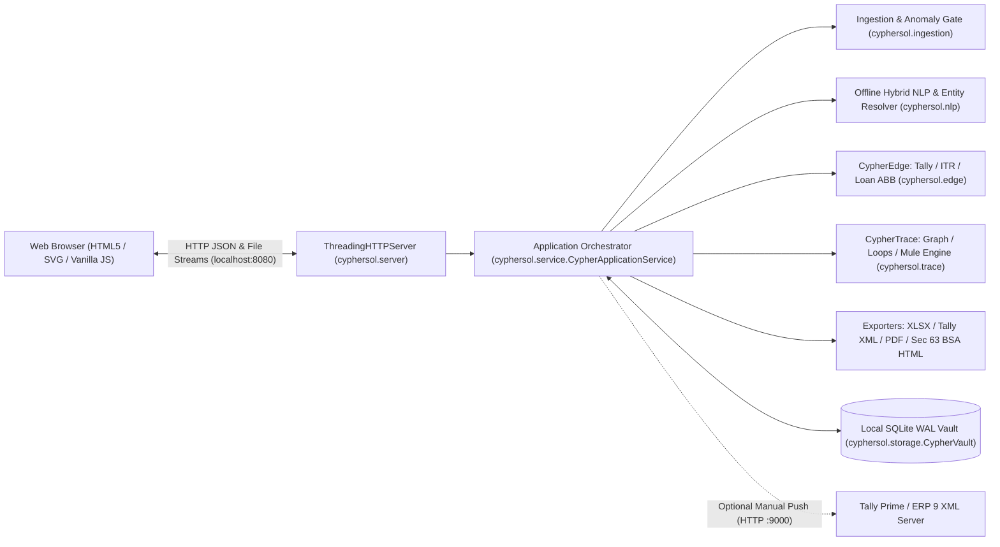

# CypherSOL Deployment & Administration Guide

**Platform:** CypherSOL v1.0.0 — Unified **CypherEdge** (Bank Statement Analyzer) & **CypherTrace** (Forensic Fund Trail Intelligence)  
**Target Audience:** DevOps / IT Administrators, Cyber Cell / EOW Infrastructure Teams, Chartered Accountant Firm IT Staff, and Developers

---

## Table of Contents

1. [Architecture & Zero-LLM / Zero-Subscription Design](#1-architecture--zero-llm--zero-subscription-design)
2. [Repository Structure](#2-repository-structure)
3. [System Prerequisites & Installing Python 3.11+](#3-system-prerequisites--installing-python-311)
4. [Step-by-Step Installation & Starting / Stopping the Application](#4-step-by-step-installation--starting--stopping-the-application)
5. [One-Click Desktop Launchers (macOS & Windows)](#5-one-click-desktop-launchers-macos--windows)
6. [CLI Reference & Vault Initialization Behavior](#6-cli-reference--vault-initialization-behavior)
7. [Optional Third-Party Accelerators & Air-Gapped Wheelhouse Deployment](#7-optional-third-party-accelerators--air-gapped-wheelhouse-deployment)
8. [Git Setup, Pre-Push Audit & CI Pipeline](#8-git-setup-pre-push-audit--ci-pipeline)
9. [Production Background Services (`systemd` / `launchd`) & TLS Reverse Proxy](#9-production-background-services-systemd--launchd--tls-reverse-proxy)
10. [Database Encryption, Hot SQLite Backups & Tally Port 9000 Setup](#10-database-encryption-hot-sqlite-backups--tally-port-9000-setup)
11. [REST API Reference](#11-rest-api-reference)
12. [Health Verification & Troubleshooting](#12-health-verification--troubleshooting)

---

## 1. Architecture & Zero-LLM / Zero-Subscription Design

CypherSOL is engineered to process sensitive client financial records and law-enforcement investigative data **100% locally on your hardware**.



### Licensing, Subscriptions, and Privacy Guarantees

| Requirement | Status in CypherSOL | Technical Explanation |
| :--- | :--- | :--- |
| **External LLM API Calls** | **0 in `heuristics` Mode (Optional in `both` / `llm` Modes)** | Runs 100% locally in **Heuristics Only** mode. When you configure BYOK API keys for **Google Gemini**, **Anthropic Claude**, or **OpenAI** (including Vision), Agents 1–4 call only your chosen provider over HTTPS using Python stdlib `urllib.request`. |
| **Paid API Keys / Secrets Storage** | **Optional BYOK (Stored Locally)** | Optional API keys provided via the deployment wizard (`--configure-llm`) or UI **AI Config** modal are stored strictly locally in your git-ignored SQLite vault (`data/cyphersol_vault.db`, table `llm_settings`) and masked (`••••`) in API responses. |
| **SaaS / Monthly Subscriptions** | **None (0)** | Runs indefinitely on local compute with zero CypherSOL license servers or third-party telemetry callbacks. |
| **Mandatory PyPI Packages** | **None (0)** | `dependencies = []` in `pyproject.toml`; core uses only Python 3.11+ standard library modules (`sqlite3`, `http.server`, `zlib`, `zipfile`, `xml.etree.ElementTree`, `difflib`, `csv`, `re`, `hashlib`, `concurrent.futures`). |
| **Offline Transaction Classification** | **Included** | `HybridTransactionCategorizer` runs a local 4-tier pipeline: user SQLite Auto-Learn rules $\to$ `12,777`-point deterministic Indian banking knowledge base $\to$ calibrated Multinomial Naive Bayes classifier trained in memory at startup $\to$ Suspense gate (`Category 52`). |

---

## 2. Repository Structure

```text
.
├── .gitignore                        # Excludes .venv/, __pycache__/, data/, *.db*, .env*, .DS_Store
├── README.md                         # Project overview & quick start
├── Start_CypherSOL.bat               # Windows one-click desktop/terminal launcher
├── Start_CypherSOL.command           # macOS Finder double-click launcher
├── start.sh                          # macOS / Linux single-command terminal launcher
├── pyproject.toml                    # Package metadata & optional accelerator extras
├── requirements.txt                  # Commented optional PyPI accelerator list
├── run_app.py                        # Smart auto-venv launcher script (adds src/ to sys.path)
├── docs/
│   ├── DEPLOYMENT_GUIDE.md           # This administrator & deployment manual
│   └── USER_GUIDE.md                 # End-user workflow manual (CypherEdge + CypherTrace)
├── sample_statements/                # 11 synthetic demo statements (.pdf, .xlsx, .csv)
├── src/cyphersol/
│   ├── cli.py                        # CLI parser & HTTP server lifecycle manager
│   ├── demo_data.py                  # Auto-generator for sample statements & 2 demo workspaces
│   ├── models.py                     # Core domain dataclasses & enums
│   ├── reporting.py                  # 6-sheet XLSX, HTML/SVG dossier & PDF exporters
│   ├── server.py                     # ThreadingHTTPServer REST API + static UI server
│   ├── service.py                    # End-to-end case orchestration layer
│   ├── storage.py                    # Thread-safe SQLite WAL repository (CypherVault)
│   ├── taxonomy.py                   # 52 categories, 113 Indian banks, 12,777 KB rules
│   ├── edge/                         # Tally XML exporter, ITR compliance, Loan ABB & FOIR
│   ├── ingestion/                    # PDF/XLSX/CSV/TXT parsers & Step 02 Anomaly Gate
│   ├── nlp/                          # Payment rail parser, 52-cat hybrid AI, Entity Resolver
│   ├── trace/                        # Force-directed graph, layering, loops, bidirectional, mule scorer
│   └── ui/                           # Zero-framework offline frontend (index.html, styles.css, app.js)
└── tests/
    └── test_cyphersol.py             # 9 automated integration & performance tests
```

---

## 3. System Prerequisites & Installing Python 3.11+

CypherSOL requires **Python `3.11` or newer** (`3.12`, `3.13`, or `3.14` recommended). Verify your Python version first:

```bash
python3 --version        # macOS / Linux
py -3 --version          # Windows
```

If Python `3.11+` is not installed:

- **macOS (Homebrew):**
  ```bash
  brew install python@3.12
  ```
- **Ubuntu / Debian Linux:**
  ```bash
  sudo apt update && sudo apt install -y python3 python3-venv
  ```
- **RHEL / Rocky / Fedora Linux:**
  ```bash
  sudo dnf install -y python3 python3-pip
  ```
- **Windows 10 / 11 (PowerShell as Administrator or User):**
  ```powershell
  winget install Python.Python.3.12
  ```
  *If using the graphical installer from python.org, check **"Add python.exe to PATH"**.*

---

## 4. Step-by-Step Installation & Starting / Stopping the Application

> **Zero-Friction Default:** `run_app.py` automatically switches into `.venv` if present, opens your default browser automatically, re-focuses an already-running instance cleanly instead of crashing on port conflicts, and falls back to ports `8081–8090` if another app occupies `8080`.

### Option A: macOS & Linux (`zsh` / `bash`)

1. **Open Terminal and navigate to the project root folder:**
   ```bash
   cd /path/to/cyphersol
   ```
2. **Start CypherSOL with one command (bootstraps `.venv` on first run if needed):**
   ```bash
   ./start.sh
   ```
   *(Or run `python3 run_app.py` directly — no `.venv/bin/python` prefix or `--open-browser` flag needed.)*

3. **Expected Console Output:**
   ```text
   ====================================================================
   CypherSOL Offline Platform running at http://127.0.0.1:8080/
   Vault DB:          /path/to/cyphersol/data/cyphersol_vault.db
   Sample Statements: /path/to/cyphersol/sample_statements
   Press Ctrl + C in this window to stop the server.
   ====================================================================
   ```
   Your default browser opens automatically to `http://127.0.0.1:8080/`. Keep this terminal window open while using the application.

4. **Stopping the Application:**
   Press **`Ctrl + C`** in the terminal window:
   ```text
   Shutting down CypherSOL server.
   ```

---

### Option B: Windows 10 / 11 (PowerShell or CMD)

1. **Open Windows Terminal / PowerShell and change into the project directory:**
   ```powershell
   cd C:\path\to\cyphersol
   ```
2. **Start CypherSOL with one command (bootstraps `.venv` on first run if needed):**
   ```powershell
   .\Start_CypherSOL.bat
   ```
   *(Or run `py -3 run_app.py` directly without activating `.venv`.)*

3. **If you prefer creating and activating `.venv` manually in PowerShell:**
   ```powershell
   Set-ExecutionPolicy -ExecutionPolicy RemoteSigned -Scope CurrentUser
   py -3 -m venv .venv
   .\.venv\Scripts\Activate.ps1
   python run_app.py
   ```
4. **Stopping:** Press **`Ctrl + C`** in PowerShell/CMD.

---

### Option C: Install as a Global CLI Command Inside `.venv`

To invoke CypherSOL via the `cyphersol` command defined in `pyproject.toml`:

```bash
source .venv/bin/activate      # On Windows: .\.venv\Scripts\Activate.ps1
pip install --no-build-isolation --no-deps -e .
cyphersol
```

---

## 5. Built-In One-Click Desktop Launchers (macOS, Linux & Windows)

Three ready-to-use launcher scripts are **included in the repository root** for non-technical auditors and CA staff — no script creation or manual venv commands needed:

- **`Start_CypherSOL.command` (macOS Finder):** Double-click directly in Finder. On first launch, if macOS Gatekeeper asks to verify the script, Right-Click `Start_CypherSOL.command` $\to$ **Open** $\to$ **Open**.
- **`Start_CypherSOL.bat` (Windows Explorer / CMD / PowerShell):** Double-click directly in File Explorer.
- **`start.sh` (macOS / Linux Terminal):** Run `./start.sh` in the repo root.

All three launchers automatically suppress `__pycache__` writes (`-B` / `PYTHONDONTWRITEBYTECODE=1`), initialize `.venv` on first launch if absent, pass through any optional CLI arguments (e.g. `./start.sh --port 8090`), and open the UI in the default browser automatically.

---

## 6. CLI Reference & Vault Initialization Behavior

All flags accepted by `run_app.py`, `start.sh`, `Start_CypherSOL.command`, `Start_CypherSOL.bat`, and the `cyphersol` entry point:

| Flag | Type | Default | Description |
| :--- | :--- | :--- | :--- |
| `--host` | String | `127.0.0.1` | Network bind address. Keep `127.0.0.1` for single-PC use; use `0.0.0.0` only behind a LAN firewall/TLS reverse proxy. |
| `--port` | Integer | `8080` | Preferred TCP listening port. If CypherSOL is already running on `--port`, it opens the active browser tab and exits cleanly; if another app occupies it, CypherSOL falls back automatically to the first free port in `8081–8090`. |
| `--db` | File Path | `data/cyphersol_vault.db` | SQLite WAL database path. Parent directories are created automatically. |
| `--samples` | Dir Path | `sample_statements` | Target folder where demo statements are written/read. |
| `--open-browser` | Flag | Enabled by default | Retained for backward compatibility; browser launches automatically unless `--no-browser` is passed. |
| `--no-browser` | Flag | `False` | Disables automatic browser launch (recommended for `systemd`, `launchd`, containers, and SSH sessions). |
| `--configure-llm` | Flag | `False` | Launches the interactive deployment wizard to choose runtime mode (`both` / `heuristics` / `llm`), LLM provider (`gemini` / `claude` / `openai`), text/vision models, and masked API key stored in SQLite. |
| `--non-interactive` | Flag | `False` | Skips the first-run interactive LLM setup prompt (recommended for CI, `systemd`, `launchd`, and headless servers). |
| `--execution-mode` | Choice | Saved vault mode | Overrides the active runtime execution mode at startup (`heuristics`, `both`, or `llm`). |

### First-Run Seeding vs. Clean Case Vault
- On first startup when `--db` points to a new/empty SQLite database, `ensure_demo_cases_seeded()` automatically populates two ready-to-explore cases: `CASE_EDGE_BALAJI_FY25` and `CASE_TRACE_EOW_041`.
- **Starting a clean production vault on an encrypted drive:**
  ```bash
  ./start.sh --db /Volumes/EncryptedCaseDrive/eow_2026_vault.db
  ```
- **Resetting the default local database back to fresh demo state:** Stop the server (`Ctrl + C`), delete `data/cyphersol_vault.db*`, and restart `./start.sh` (or `python3 run_app.py`).

---

## 7. Optional Third-Party Accelerators & Air-Gapped Wheelhouse Deployment

The pure-Python stdlib engine handles CSV, TSV, TXT, `.xlsx`, native PDFs, Excel generation, Tally XML, and PDF dossier creation without extra installs. For scanned/complex bank PDFs or AES-encrypted bank PDFs (`pikepdf`), install the optional packages listed in `requirements.txt`.

| Accelerator Package | Automatic Enhancement Provided | Fallback Without Package |
| :--- | :--- | :--- |
| `pdfplumber` / `PyMuPDF` | Faster extraction on multi-column / complex PDF tables | Built-in pure-Python PDF stream & header-inference extractor |
| `pikepdf` | Decrypts AES-256 / RC4 password-protected bank PDFs | Pure-Python PDF reader (unencrypted native PDFs) |
| `openpyxl` | Reads legacy/complex styled workbooks | Built-in pure-Python OpenXML ZIP/XML reader & writer |
| `rapidfuzz` | C-speed Levenshtein/Jaro-Winkler clustering on 50k+ rows | Built-in `difflib` + Indian phonetic canonicalization |

### Online Accelerator Install

```bash
source .venv/bin/activate
pip install pdfplumber pikepdf openpyxl rapidfuzz
```

### Air-Gapped / Offline Workstation Transfer

1. **On an internet-connected staging PC:**
   ```bash
   mkdir wheelhouse
   pip download -d wheelhouse pdfplumber pikepdf openpyxl rapidfuzz
   ```
2. **Transfer the project folder + `wheelhouse/` to the air-gapped PC.**
3. **Install offline with zero network calls:**
   ```bash
   python3 -m venv .venv
   source .venv/bin/activate
   pip install --no-index --find-links=./wheelhouse pdfplumber pikepdf openpyxl rapidfuzz
   python run_app.py --host 127.0.0.1 --port 8080 --no-browser
   ```

---

## 8. Git Setup, Pre-Push Audit & CI Pipeline

### Step 1: Pre-Push Privacy & Cleanliness Check

Verify no virtual environments, runtime SQLite files, bytecode caches, or secrets will be staged:

```bash
# Optional: clean any Python bytecode caches and macOS Finder metadata
find . -maxdepth 4 -not -path './.venv*' \( -name "__pycache__" -o -name ".DS_Store" \) -exec rm -rf {} +

# Verify zero runtime DBs or secret files exist in workspace
find . -maxdepth 4 -not -path './.venv*' \( -name "*.db*" -o -name ".env*" -o -name "*.pem" -o -name "*.key" \)
```

### Step 2: Initialize, Commit, and Push to Remote

```bash
git init -b main
git status                       # Confirm .venv/, data/, __pycache__/, and *.db are ignored
git add .
git commit -m "Initial commit: CypherSOL (CypherEdge + CypherTrace) offline suite"
git remote add origin <YOUR_GIT_REPOSITORY_URL>
git push -u origin main
```

### Step 3: Recommended CI Workflow (`.github/workflows/ci.yml`)

```yaml
name: CypherSOL Tests
on: [push, pull_request]
jobs:
  test:
    runs-on: ubuntu-latest
    steps:
      - uses: actions/checkout@v4
      - uses: actions/setup-python@v5
        with:
          python-version: "3.12"
      - name: Run Offline Unit & Integration Suite
        run: python -B -W default -m unittest discover -s tests -v
```

---

## 9. Production Background Services (`systemd` / `launchd`) & TLS Reverse Proxy

### Linux `systemd` Service

1. Create a dedicated system user and install the code under `/opt/cyphersol`:
   ```bash
   sudo useradd -r -s /bin/false cyphersol
   sudo mkdir -p /var/lib/cyphersol
   sudo chown -R cyphersol:cyphersol /opt/cyphersol /var/lib/cyphersol
   ```
2. Create `/etc/systemd/system/cyphersol.service`:
   ```ini
   [Unit]
   Description=CypherSOL Offline Bank Statement & Forensic Intelligence Platform
   After=network.target

   [Service]
   Type=simple
   User=cyphersol
   WorkingDirectory=/opt/cyphersol
   ExecStart=/opt/cyphersol/.venv/bin/python -B /opt/cyphersol/run_app.py --host 127.0.0.1 --port 8080 --no-browser --db /var/lib/cyphersol/vault.db
   Restart=on-failure
   RestartSec=5

   [Install]
   WantedBy=multi-user.target
   ```
3. Enable and verify:
   ```bash
   sudo systemctl daemon-reload
   sudo systemctl enable --now cyphersol
   sudo systemctl status cyphersol
   ```

### macOS `launchd` Daemon

Save to `~/Library/LaunchAgents/com.cyphersol.platform.plist` (update `/path/to/cyphersol` before loading):

```xml
<?xml version="1.0" encoding="UTF-8"?>
<!DOCTYPE plist PUBLIC "-//Apple//DTD PLIST 1.0//EN" "http://www.apple.com/DTDs/PropertyList-1.0.dtd">
<plist version="1.0">
<dict>
  <key>Label</key><string>com.cyphersol.platform</string>
  <key>ProgramArguments</key>
  <array>
    <string>/path/to/cyphersol/.venv/bin/python</string>
    <string>-B</string>
    <string>/path/to/cyphersol/run_app.py</string>
    <string>--host</string><string>127.0.0.1</string>
    <string>--port</string><string>8080</string>
    <string>--no-browser</string>
  </array>
  <key>WorkingDirectory</key><string>/path/to/cyphersol</string>
  <key>RunAtLoad</key><true/>
  <key>KeepAlive</key><true/>
</dict>
</plist>
```

Load via:
```bash
launchctl load ~/Library/LaunchAgents/com.cyphersol.platform.plist
```

### Multi-Analyst LAN HTTPS Reverse Proxy (Nginx)

Keep CypherSOL bound strictly to `127.0.0.1:8080` and terminate TLS in Nginx:

```nginx
server {
    listen 443 ssl;
    server_name forensics.internal.local;

    ssl_certificate     /etc/ssl/certs/cyphersol.crt;
    ssl_certificate_key /etc/ssl/private/cyphersol.key;
    client_max_body_size 150M;

    location / {
        proxy_pass http://127.0.0.1:8080;
        proxy_set_header Host $host;
        proxy_set_header X-Forwarded-For $remote_addr;
        proxy_read_timeout 180s;
    }
}
```

---

## 10. Database Encryption, Hot SQLite Backups & Tally Port 9000 Setup

- **At-Rest Encryption:** Store `--db /secure/path/vault.db` on a disk encrypted with **FileVault** (macOS), **BitLocker** (Windows), or **LUKS/dm-crypt** (Linux).
- **Safe Online Hot Backup (While Server Runs in WAL Mode):**
  ```bash
  python3 -c "import sqlite3; s=sqlite3.connect('data/cyphersol_vault.db'); d=sqlite3.connect('backups/vault_backup.db'); s.backup(d); d.close(); s.close()"
  ```
- **Configuring Tally Prime / Tally.ERP 9 for One-Click HTTP Sync:**
  1. Open Tally on your workstation (`127.0.0.1`) or LAN accounting PC.
  2. Press **`F12` (Configure)** $\to$ **Advanced Configuration** (in Tally Prime: **F1 Help $\to$ Settings $\to$ Connectivity $\to$ Client/Server configuration**).
  3. Set **TallyPrime acts as**: `Both` (or `Server`), and **Port**: `9000`.
  4. Accept restart in Tally. CypherEdge's `Push to Tally (HTTP :9000)` button will then post XML vouchers directly into your active open Company.

---

## 11. REST API Reference

All endpoints are served from `http://127.0.0.1:8080`:

| Method | Path | Purpose |
| :--- | :--- | :--- |
| `GET` | `/api/health` | Health status, supported bank count (`113`), category count (`52`), KB points (`12777`) |
| `GET` | `/api/meta` | Full 52-category catalog, 113 banks, saved PDF Draw templates, and masked LLM/Agent catalog config |
| `GET` | `/api/llm/config` | Retrieve masked LLM/Vision configuration, supported providers (`gemini`, `claude`, `openai`), and Agents 1–4 definitions |
| `POST` | `/api/llm/config` | Update runtime mode (`heuristics` \| `both` \| `llm`), provider, text/vision models, per-stage agent toggles, and BYOK API key |
| `POST` | `/api/llm/test` | Live-probe connectivity & authentication against the selected Gemini, Claude, or OpenAI endpoint |
| `GET` | `/api/cases` | List all workspaces / investigation cases |
| `POST` | `/api/cases` | Create a new case (`title`, `mode`: `cypher_trace` \| `cypher_edge`, `agency_or_firm_name`) |
| `POST` | `/api/draw-templates` | Save reusable PDF Draw Tool coordinates (`bank_code`, `table_bbox`, `column_splits`) |
| `GET` | `/api/cases/{id}/overview` | Statements, transactions, anomalies, entities, summary KPIs, audit logs, and latest agent telemetry |
| `POST` | `/api/cases/{id}/pdf-preview` | Extract positioned Page-1 tokens for Draw Tool calibration |
| `POST` | `/api/cases/{id}/upload` | Ingest base64-encoded `.pdf`, `.xlsx`, `.csv`, `.tsv`, `.txt`, `.png`, or `.jpg` files with optional `execution_mode` override |
| `POST` | `/api/cases/{id}/run-agents` | Re-run Stage 2–4 Heuristic and/or LLM Backup Agents on an existing case (`execution_mode`, `stages`) |
| `POST` | `/api/cases/{id}/transactions/{tx_id}/resolve` | Resolve Suspense category & optionally save Auto-Learn rule |
| `POST` | `/api/cases/{id}/transactions/{tx_id}/toggle-duplicate` | Ignore or restore a duplicate-flagged transaction |
| `POST` | `/api/cases/{id}/entities/recluster` | Re-run fuzzy/phonetic entity clustering or apply manual alias merge |
| `GET` | `/api/cases/{id}/edge/tally` | Generate Tally XML preview & stats (`?include_suspense=false`) |
| `POST` | `/api/cases/{id}/edge/tally-push` | Push XML to Tally (`host`, `port`) |
| `GET` | `/api/cases/{id}/edge/itr` | Compute FY ITR compliance, income heads & statutory red flags |
| `GET` | `/api/cases/{id}/edge/loan` | Compute Daily/Fixed-Date ABB & loan eligibility (`?foir=55&rate=11.5&tenure=60`) |
| `GET` | `/api/cases/{id}/trace/layering` | Build multi-hop layering tree (`?source_entity_id=...&window_days=14&max_depth=4`) |
| `POST` | `/api/cases/{id}/trace/layering/misc` | Move/restore entity node in Layering Misc bucket |
| `GET` | `/api/cases/{id}/trace/graph` | Force-directed network graph & centrality (`?min_amount=0&channel=ALL&keyword=`) |
| `GET` | `/api/cases/{id}/trace/mules` | 10-parameter behavioral mule risk scorecards |
| `GET` | `/api/cases/{id}/trace/loops` | Circular round-trip loops (`?max_days=30&min_retention=0.50`) |
| `GET` | `/api/cases/{id}/trace/bidirectional` | Bidirectional mutual flows (`?a=...&b=...`) |
| `GET` | `/api/cases/{id}/trace/profile` | Subject financial profile (`?entity_id=...`) |
| `GET` | `/api/cases/{id}/export/xlsx` | Download 6-sheet `.xlsx` audit workbook |
| `GET` | `/api/cases/{id}/export/tally-xml` | Download Tally `.xml` import file |
| `GET` | `/api/cases/{id}/export/dossier-html` | Render Section 63 BSA printable HTML/SVG dossier |
| `GET` | `/api/cases/{id}/export/dossier-pdf` | Download native `.pdf` dossier |

---

## 12. Health Verification & Troubleshooting

### Run Full Automated Test Suite

```bash
.venv/bin/python -B -W default -m unittest discover -s tests -v
```

### Verify Live Server Health

```bash
curl -s http://127.0.0.1:8080/api/health
```

### Common Issues & Fixes

| Symptom | Cause | Solution |
| :--- | :--- | :--- |
| Port `8080` occupied / another instance running | An earlier CypherSOL server or another service is listening on `8080`. | If CypherSOL is already running, re-running `./start.sh` opens the existing browser tab cleanly; if another service occupies `8080`, CypherSOL automatically shifts to `8081–8090` (or pass `--port 8090`). |
| `No module named 'cyphersol'` | Running `python -m ...` without `run_app.py` or editable install. | Always start via `./start.sh`, `Start_CypherSOL.bat`, or `python3 run_app.py` from the project root. |
| PowerShell blocks `Activate.ps1` | Default Windows execution policy restricts local scripts. | Run `.\Start_CypherSOL.bat` or `py -3 run_app.py` (no script activation required), or run `Set-ExecutionPolicy -ExecutionPolicy RemoteSigned -Scope CurrentUser`. |
| Uploaded bank PDF shows shifted columns | Non-standard PDF table spacing or custom bank template. | Use **Open in PDF Draw Tool** in Tab 01 to set exact `Splitters (% width)` and `BBox`, save as a template, and re-upload. |
| Encrypted PDF fails to parse | Optional `pikepdf` library is not installed for encrypted streams. | Install `pikepdf` (`pip install pikepdf`) or remove the PDF password before uploading. |
| `Tally Sync Failed: Connection refused` | Tally is closed or its XML HTTP server on port `9000` is disabled. | Enable Tally Client/Server on port `9000`, or use **Download Tally XML** and import the `.xml` manually inside Tally. |
