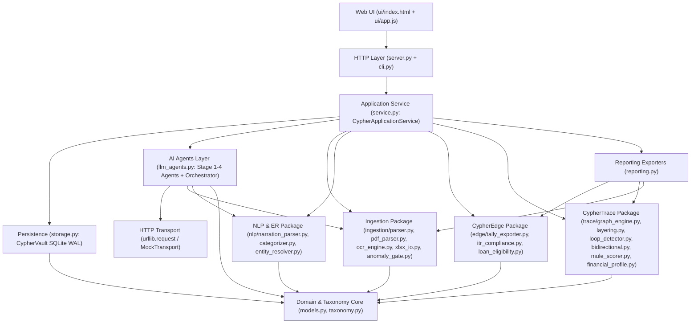
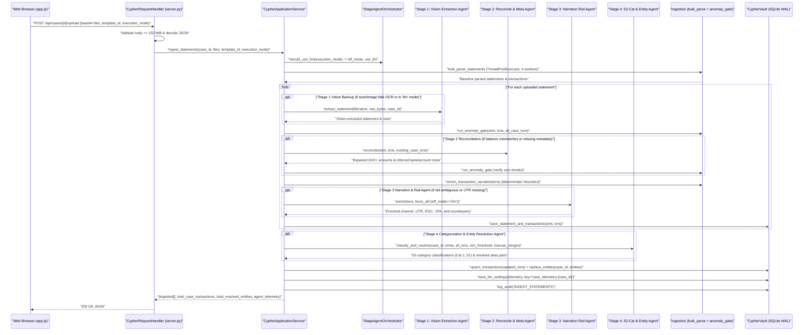

# CypherSOL Developer & Software Architecture Guide

**Audience:** Software Engineers, Tech Leads, Maintainers, Code Reviewers, Contributors  
**Target Codebase:** CypherSOL v1.0.0 (`cyphersol` package under `src/cyphersol/`)  
**Related Reference:** See [DATA_AND_VARIABLE_DICTIONARY.md](DATA_AND_VARIABLE_DICTIONARY.md) for every Enum, dataclass field, SQLite column, threshold, regex, and API schema.

---

## Table of Contents

1. [Architectural Principles & Layered Package Topology](#1-architectural-principles--layered-package-topology)
2. [Core Execution Flows (Sequence Diagrams)](#2-core-execution-flows-sequence-diagrams)
3. [Subsystem Engineering & Mathematical Specifications](#3-subsystem-engineering--mathematical-specifications)
4. [Maintenance & Extension Playbooks (How to Safely Update CypherSOL)](#4-maintenance--extension-playbooks)
5. [Testing, Benchmarking, Security Hardening & Code Standards](#5-testing-benchmarking-security-hardening--code-standards)

---

## 1. Architectural Principles & Layered Package Topology

### Core Engineering Invariants
1. **Zero Mandatory Third-Party Dependencies:** The core runtime (`dependencies = []` in `pyproject.toml`) runs strictly on Python `3.11+` standard library primitives (`sqlite3`, `http.server`, `urllib.request`, `zlib`, `zipfile`, `xml.etree.ElementTree`, `difflib`, `csv`, `re`, `hashlib`, `statistics`, `concurrent.futures`). Multi-provider LLM API calls (Google Gemini, Anthropic Claude, OpenAI) use `urllib.request` directly. Optional packages (`pdfplumber`, `pikepdf`, `openpyxl`, `rapidfuzz`) enhance performance or encrypted PDF parsing automatically via guarded `try: import ... except ImportError:` fallbacks without breaking base portability.
2. **Thread-Safe Local Persistence (`CypherVault`):** All SQLite mutations and queries execute under `threading.RLock()` inside short-lived context-managed WAL connections (`storage._connect()`). No global mutable state lives outside the database or explicit service caches (`HybridTransactionCategorizer.user_rules`). Sensitive BYOK API keys are stored strictly locally in the git-ignored vault (`data/cyphersol_vault.db`, table `llm_settings`) and are masked (`••••`) in all API responses.
3. **Flexible Runtime Execution Modes (`heuristics`, `both`, `llm`):**
   - **`heuristics` (100% Offline):** Zero external calls; relies strictly on deterministic Indian bank narration grammars, 113 bank fingerprints, 12,777-point knowledge base, and local Multinomial Naive Bayes.
   - **`both` (Hybrid Backup):** Deterministic heuristics execute first; Stages 1–4 LLM/Vision backup agents are invoked only where needed (unreadable scans, running-balance breaks, ambiguous payment rails, Suspense/low-confidence transactions, and near-similarity entity aliases).
   - **`llm` (LLM Primary):** Dispatches statements directly to the 4 Stage AI agents, falling back cleanly to deterministic heuristics if an API failure occurs.
4. **Pure-Function Analytics Modules:** Everything under `ingestion/`, `nlp/`, `edge/`, `trace/`, and `reporting.py` takes immutable inputs (`List[BankAccountStatement]`, `List[NormalizedTransaction]`, `List[ResolvedEntity]`) and returns deterministic dataclasses or dicts without performing disk I/O directly. Only `CypherVault` reads/writes SQLite, and `CypherApplicationService` coordinates both.
5. **Precision Boundary:** Raw statement parsing and running balance validation (`ingestion/anomaly_gate.py`) use `decimal.Decimal` at `0.01` precision; downstream graph/scoring analytics convert to `float` and exclude transactions with `is_duplicate_ignored = True`.

### Dependency Architecture



### Package Responsibility Map

| Module Path | Responsibility | Owns I/O? |
| :--- | :--- | :--- |
| `src/cyphersol/__init__.py` | Public package API exports (`__version__`, `CypherApplicationService`, `CypherVault`, `run_server`) | No |
| `src/cyphersol/models.py` | Domain dataclasses, Enums, and recursive JSON serializer (`serialize_value`) | No |
| `src/cyphersol/taxonomy.py` | `52` category specs, `113` Indian bank profiles, deterministic `12,777`-point KB builder | No |
| `src/cyphersol/storage.py` | SQLite WAL schema (`12` tables including `case_inputs`, `case_outputs`, `llm_settings`, `10` indexes), `RLock` thread safety, CRUD operations | **Yes (SQLite)** |
| `src/cyphersol/llm_agents.py` | Multi-provider client (Gemini, Claude, OpenAI), multimodal Vision extractor, Stages 1–4 Backup Agents, `StageAgentOrchestrator`, and telemetry | **Yes (Outbound HTTPS via stdlib urllib)** |
| `src/cyphersol/demo_data.py` | First-boot sample file generator (`11` files) and demo case seeder | **Yes (samples dir)** |
| `src/cyphersol/service.py` | Transactional orchestration across storage, ingestion, NLP, Stage 1–4 agents, Edge, Trace, and exports | Coordinates `CypherVault` |
| `src/cyphersol/server.py` | `ThreadingHTTPServer`, REST router, input/body validation (`400`/`413`), security headers | **Yes (HTTP)** |
| `src/cyphersol/cli.py` | Argparse CLI, structured logging, interactive deployment setup wizard (`--configure-llm`), port fallback | **Yes (OS / Browser / Stdin)** |
| `src/cyphersol/ingestion/ocr_engine.py` | Offline OCR pipeline (`tesseract` CLI $\to$ Apple `Vision` $\to$ pure-Python `/FlateDecode` + glyph OCR) & scanned PDF fixture generator | **Spawns OCR subprocesses (`tesseract` / `pdftoppm`)** |
| `run_app.py` | Executable launcher with bytecode suppression (`-B`) and automatic `.venv` re-exec | **Yes (Process)** |

---

## 2. Core Execution Flows (Sequence Diagrams)

### 2.1 Multi-Stage Bulk Upload, Ingestion, Anomaly Gate & Agent Orchestration



### 2.2 Suspense Auto-Learn Propagation (`POST /api/cases/{id}/transactions/{tx_id}/resolve`)

1. `CypherApplicationService.resolve_suspense()` loads all transactions for `case_id`.
2. `apply_suspense_resolution()` extracts a normalized `learned_pat` from the anchor transaction (`extracted_counterparty`, fallback `counterparty_vpa_or_acc`, fallback `raw_narration[:32]`).
3. Updates `HybridTransactionCategorizer` in memory (`add_user_rule`) and persists the rule globally in `user_rules` via `vault.save_user_rule(learned_pat, direction, category_id, custom_ledger)`.
4. If `auto_refresh_similar=True`, every other transaction in the case sharing `direction` whose narration/counterparty contains `learned_pat` is promoted to `categorization_source = "USER_RULE"` and `confidence_score = 1.0`.

---

## 3. Subsystem Engineering & Mathematical Specifications

### 3.1 Ingestion, Native PDF, Scanned OCR & Tabular Parsing (`src/cyphersol/ingestion/`)

- **4-Tier PDF Extractor (`pdf_parser.py`):**
  1. Encrypted `/Encrypt` PDFs attempt `pikepdf` decryption, then `qpdf --password=... --decrypt`, or owner-restriction check via Poppler before returning `PdfExtractionResult(is_encrypted=True)`.
  2. Pure-Python PDF object & stream parser (`_parse_pdf_objects`, `_parse_tounicode_cmap` for `beginbfchar`/`beginbfrange`, `_extract_content_tokens`) inflates `/FlateDecode` streams, decodes hex `<...>` strings and `ToUnicode` CMaps, and tracks `Tm`/`Td`/`TD`/`T*`/`Tj`/`TJ` operators into positioned `PdfTextToken(page, x, y, text, x_end)` records.
  3. **Poppler & `pdfplumber` Fallbacks:** When pure-Python extraction hits CID/`Identity-H`/Skia fragmented streams (too few tokens, average token length `< 2.2`, or missing multi-column `x` spread), `_extract_tokens_pdftotext()` runs `pdftotext -bbox-layout` XML extraction (with optional `pdfplumber` fallback).
  4. **Stacked Header Merging & Gutter-Aware Column Alignment (`_infer_table_header_splits` + `_compute_gutter_splits` + `_assign_line_to_columns`):** `_merge_header_candidate_tokens` merges stacked two-line headers (`y_gap <= 14.0` pt), scores `x`-separated anchors matching `_HEADER_KEYWORDS` (`22` tokens), computes vertical whitespace gutters across table data rows (`_compute_gutter_splits`) so right-aligned numeric columns never bleed into adjacent cells, and slices rows strictly by column interval.
  5. **Scanned PDF OCR Handoff:** When extractable native text tokens are absent or image streams dominate (`needs_ocr=True`), `extract_pdf_data()` automatically invokes `ocr_pdf_bytes()`.
- **Offline Scanned PDF & Image OCR Engine (`ocr_engine.py`):**
  - `ocr_pdf_bytes()` and `ocr_image_bytes()` run a 3-tier zero-cloud OCR cascade and emit `OcrWordToken(page, x, y, text, x_end)` records grouped back into table cells:
    1. `tesseract` CLI (via `pdftoppm` rasterization for PDFs).
    2. macOS Apple `Vision` framework (`VNRecognizeTextRequest` via `ctypes`), automatically skipped if sandboxed `CVPixelBuffer` allocation fails.
    3. Pure-Python embedded image & glyph recognizer (`_extract_embedded_pdf_images`, `_decode_png`, `_decode_bmp`, `_decode_pnm`, `_ocr_gray_image_pure_python` with `5x7` normalized bitmap template matching).
  - `generate_scanned_pdf_statement()` creates genuine image-only `/Image` PDFs (zero `BT` text operators) for offline OCR verification.
- **Unified Statement Parser (`parser.py`):**
  - Routes `.pdf`, direct image scans (`_IMAGE_EXTENSIONS`: `.png`, `.jpg`, `.jpeg`, `.pgm`, `.ppm`, `.bmp`, `.tif`, `.tiff`), `.xlsx`/`.xlsm`, `.csv`, `.tsv`, and `.txt` into normalized `BankAccountStatement` + `NormalizedTransaction` lists, then enriches every parsed row via `enrich_transaction_narration()`.
  - Supports `18` Indian/ISO date formats (`_DATE_FORMATS`), ordered word-boundary column synonym mapping (`_HEADER_SYNONYMS`), line-anchored page/summary footer exclusion (`_FOOTER_LINE_RE` preserving legitimate corporate names such as `"PAGE INDUSTRIES LTD"`), pre/post multi-line narration stitching, and `_resolve_ambiguous_directions()` (running-balance continuity solver against header `Opening Balance` for single unsigned `Amount` columns).
- **Pure-Python OpenXML Workbook Engine (`xlsx_io.py`):**
  - Reads `xl/sharedStrings.xml`, `xl/styles.xml` (custom and built-in Excel date format IDs `14..22`), `xl/workbook.xml`, and `xl/worksheets/*.xml` directly via `zipfile` + `xml.etree.ElementTree`, converting Excel serial dates cleanly from epoch `1899-12-30`.
  - `write_xlsx_bytes()` builds valid multi-sheet `.xlsx` ZIP archives with a styled header `styles.xml` (`font` bold white on navy `#0F4C81`), `auto_filter` / numeric types, and auto-sized column widths.
- **Step 02 Anomaly Gate (`anomaly_gate.py`):**
  - Detects both multi-day descending statements (`txn_date[0] > txn_date[-1]`) and same-day reverse-chronological ordering (`same_day_desc_bal`, comparing `_count_balance_matches()` forward vs reversed), normalizing them into ascending chronological order and recomputing `opening_balance` / `closing_balance`.
  - Verifies row-to-row balance continuity ($\lvert \text{Bal}_t - (\text{Bal}_{t-1} + \text{Cr}_t - \text{Dr}_t) \rvert \le \text{Decimal}("0.05")$).
  - Detects duplicate 5-tuple signatures `(account_no, date, debit, credit, running_balance)` both intra-file and against `existing_case_txns`.

### 3.2 Offline NLP & Entity Resolution (`src/cyphersol/nlp/`)

- **3-Tier Indian Banking Narration Parser (`narration_parser.py`):**
  1. **Universal Identifier Extractors:** Extracts 11-char IFSC codes (`_IFSC_RE`), UPI VPAs validated against `_KNOWN_UPI_PSP_HANDLES` (`_VPA_RE`, `_VPA_HYPHENATED_RE`), SFMS/UPI UTR & 12-digit RRN references (`_UTR_ALPHA_LONG_RE`, `_UTR_SFMS_SEQ_RE`, `_RRN_12_RE`, tagged refs), and masked account numbers (`_ACC_MASKED_RE`).
  2. **Boundary-Aware Rail Classifier (`detect_channel()`):** Strips bank transaction wrappers (`TO TRANSFER-`, `BY TRANSFER-`) and matches explicit leading rail headers (`AEPS`, `IMPS`, `RTGS`, `NEFT`, `UPI`, `NACH`, `ATM`, `CASH_CDM`, `CASH_WDL`, `POS`, `CHEQUE`, `INTEREST`, `CHARGES`, `FOREX`, `TRANSFER`) so corporate names like `"JUPITER HOSPITALITY"` (`UPI` substring) or `"MAHATMA TRUST"` (`ATM` substring) never hijack channel classification.
  3. **Rail-Specific Positional Slot Grammars:** Routes to dedicated parsers (`_parse_upi`, `_parse_neft_rtgs`, `_parse_imps`, `_parse_nach`, `_parse_pos`, `_parse_cheque`, `_parse_internal_transfer`) aware of SBI `*`/`/` slots, HDFC hyphen/slash formats, ICICI `MMT/IMPS`/`BIL/INFT`/`VPS`, Axis/Kotak/PNB slash templates, `_KNOWN_BANK_CODES`, short alphanumeric ref skipping, and `_looks_like_remark()` filtering, emitting `ParsedNarration(..., remarks, matched_grammar)`.
- **Hybrid 52-Category Classifier (`categorizer.py`):** Evaluates tiers in strict precedence:
  1. **User Auto-Learn Rules (`USER_RULE`)** — confidence `0.99`.
  2. **Channel Short-Circuits (`RULE_KB_7500`)** — ATM/AEPS/Cash withdrawal (`Cat 51`, `0.96–0.97`) and Cash CDM deposit (`Cat 50`, `0.97`).
  3. **12,777-Point Deterministic KB (`RULE_KB_7500`)** — direction-aligned substring matching boosted (`+20`) on delimiter boundaries (`0.80–0.98`).
  4. **Calibrated Multinomial Naive Bayes (`ML_MODEL` vs `SUSPENSE`):**
     Trained offline in memory at instantiation on character 3/4-grams, word tokens, `dir:`, and `ch:` features over `KNOWLEDGE_BASE_PATTERNS` using Laplace smoothing $\alpha = 0.5$, direction mismatch penalty $-4.5$, and temperature-scaled softmax ($\tau^{-1} = 0.45$):
     $$P(c \mid x) = \frac{\exp\big(0.45 \cdot (s_c - \max_k s_k)\big)}{\sum_k \exp\big(0.45 \cdot (s_k - \max_k s_k)\big)}$$
     Predictions below `confidence_threshold` (`0.65`) fall into `Category 52 (Suspense / Uncategorized)` while preserving `top3_suggestions`.
- **Entity Resolution (`entity_resolver.py`):** Uses Disjoint-Set (Union-Find with path compression, prioritizing merging into `has_statement` holders) over three signals:
  1. Explicit `manual_merges` overrides.
  2. Shared UPI VPA / account identifiers.
  3. Pairwise hybrid score combining Token Sort (`0.40`), Jaro-Winkler (`0.25`), Indian Phonetic key similarity (`0.20`), and Token Set (`0.15`), flooring at `0.90` on identical phonetic keys ($\ge 4$ chars).

### 3.3 CypherEdge Engines (`src/cyphersol/edge/`)

- **Tally Prime XML Exporter (`tally_exporter.py`):** Follows Tally's signed double-entry convention:
  - Receipt (`CR`): Bank ledger `ISDEEMEDPOSITIVE="Yes"` (`-amt`), Party/Income `ISDEEMEDPOSITIVE="No"` (`+amt`).
  - Payment (`DR`): Party/Expense `ISDEEMEDPOSITIVE="Yes"` (`-amt`), Bank ledger `ISDEEMEDPOSITIVE="No"` (`+amt`).
  - Pre-existing `Cash` ledger creation is skipped automatically; ledger names are truncated safely to `<= 64` XML-escaped characters.
- **Loan Eligibility & ABB (`loan_eligibility.py`):** Builds a dense day-by-day closing balance series carrying forward opening balances across zero-transaction holidays:
  - `daily_abb` = arithmetic mean across all calendar days in month.
  - `fixed_date_abb` = arithmetic mean sampled strictly on `{5, 10, 15, 20, 25, last_day_of_month}`.
  - Monthly EMI ceiling & eligible principal loan:
    $$\text{Max EMI} = \max\Big(0,\; I_{\text{assess}} \cdot \frac{\text{FOIR}}{100} - \text{Existing EMI}\Big), \qquad P_{\max} = \text{Max EMI} \cdot \frac{(1+r)^n - 1}{r (1+r)^n}$$
    where $r = \frac{\text{annual\_rate}}{12 \times 100}$ and $n = \text{tenure\_months}$.

### 3.4 CypherTrace Engines (`src/cyphersol/trace/`)

- **Directed Multigraph & Centrality (`graph_engine.py`):**
  - `extract_directed_transfer_events()` sorts debits before credits so when statements for both sender `A` and receiver `B` are uploaded, `B`'s mirrored credit `(A, B, amt, date)` is deduplicated against `A`'s debit — preventing double-counting of volume across hops.
  - Computes **Weighted PageRank** ($d = 0.85$, $30$ iterations, handling dangling sinks) and normalized **Brandes Shortest-Path Betweenness Centrality**.
  - Assigns each node one of 4 topological roles (`PRIMARY_HUB`, `BRIDGE_CONDUIT`, `EXIT_ENDPOINT`, `PERIPHERAL_LEAF`) before executing 70 iterations of role-weighted **Fruchterman-Reingold force-directed layout** within `[920 x 520]`.
- **Progressive Layering Tree (`layering.py`):** Expands outward from `credit_source_entity_id` up to `max_depth = 4`, filtering candidate subsequent outflows within `[earliest_inflow, earliest_inflow + window_days]` and enforcing a `115%` FIFO cap (`amt_spent * 1.15`) to avoid attributing unrelated pre-existing funds.
- **Circular Loop Detector (`loop_detector.py`):** Runs a canonical bounded DFS (`start < nxt`, avoiding duplicate permutations, `len <= max_hops`) and verifies edge-level chronological monotonicity ($\text{ts}_{k+1} \ge \text{ts}_k$), total duration $\le \text{max\_cycle\_days}$, and value retention $\frac{\min \text{amt}}{\max \text{amt}} \ge \text{min\_retention\_ratio}$.
- **10-Parameter Behavioral Mule Scorer (`mule_scorer.py`):** Aggregates 10 normalized behavioral indicators $s_i \in [0, 1]$ weighted by `PARAMETER_WEIGHTS` into a 0–100 `composite_score`: `Critical` (`80–100`), `Suspicious` (`50–79`), `Low Risk` (`0–49`). See [DATA_AND_VARIABLE_DICTIONARY.md §3.5](DATA_AND_VARIABLE_DICTIONARY.md#35-forensic-traceability--mule-dataclasses-srccyphersolmodelspy) for every formula.

### 3.5 Multi-Provider LLM & Vision Backup Agents Subsystem (`src/cyphersol/llm_agents.py`)

Designed to provide robust backup across Stages 1–4 without requiring external dependencies (`dependencies = []` in `pyproject.toml`):

- **Transport Abstraction & Multi-Provider Client (`LLMProviderClient`):**
  - Uses `HttpTransportFn` protocol (defaulting to pure stdlib `urllib.request.urlopen`) with customizable timeout and JSON parsing.
  - Dynamically builds provider-compliant payloads for:
    - **Google Gemini (`gemini-2.5-flash`, `gemini-2.5-pro`, `gemini-2.0-flash`):** Uses `/v1beta/models/{model}:generateContent?key={key}` with `contents.parts[text]` and `contents.parts[inline_data]` for images.
    - **Anthropic Claude (`claude-sonnet-4-20250514`, `claude-3-7-sonnet-latest`, `claude-3-5-haiku-latest`):** Uses `/v1/messages` with `x-api-key`, `anthropic-version: 2023-06-01`, and `messages.content[type: image, source: {type: base64, media_type, data}]`.
    - **OpenAI (`gpt-4o`, `gpt-4o-mini`, `o3-mini`):** Uses `/v1/chat/completions` with `Authorization: Bearer {key}`, `response_format: {"type": "json_object"}`, and `messages.content[type: image_url, image_url: {url: "data:{mime};base64,..."}]`.
- **4 Autonomous Stage Backup Agents:**
  1. **Stage 1 (`Stage1VisionExtractionAgent`):** Triggered when scanned PDFs/images yield zero rows or balance breaks under offline OCR. Invokes `render_statement_images_b64()`, asks the vision model for table coordinates and rows, parses amounts/dates with Indian heuristics, and runs `run_anomaly_gate()`.
  2. **Stage 2 (`Stage2ReconciliationAgent`):** Triggered when statements exhibit `BALANCE_MISMATCH` or missing account/holder metadata. Submits suspect rows with surrounding neighbors ($\pm 1$), receives proposed Dr/Cr flips or OCR digit repairs, recalculates running balances, and verifies healed continuity.
  3. **Stage 3 (`Stage3NarrationAgent`):** Triggered on unresolved narrations (`OTHER`, `TRANSFER`, or missing UTR). Extracts structured Indian payment rails (`UPI`, `NEFT`, `RTGS`, `IMPS`), UTR/RRN, IFSC, VPA, and clean uppercase counterparty entities.
  4. **Stage 4 (`Stage4CategorizationEntityAgent`):** Classifies Suspense rows (`Category 52`) or low-confidence entries (`< 0.72`) across Categories `1..51` while preserving `USER_RULE` auto-learn overrides. Simultaneously scans pairs of entity names in similarity range `[0.55, similarity_threshold)` and identifies real-world transliteration merges (`Agent 4B`).
- **Telemetry & Traceability (`StageAgentTelemetry`):** Every ingestion/re-run emits structured telemetry (`execution_mode`, `provider`, `model`, `vision_model`, `stages_invoked`, `stage_details`, `warnings`) persisted in SQLite (`case_telemetry:{case_id}`) and surfaced directly in the UI 4-Agent Status Strip.

### 3.7 Persistent Storage Architecture & Chain of Custody Repository

CypherSOL implements a disk-persisted document and export storage layer backed by SQLite metadata:

- **Storage Layout:**
  - Database: `{CYPHERSOL_DATA_DIR}/cyphersol_vault.db` (SQLite with WAL mode).
  - Raw Ingested & Uploaded Files: `{CYPHERSOL_DATA_DIR}/cases/{case_id}/inputs/{sha256[:12]}_{clean_name}`.
  - Export Archives: `{CYPHERSOL_DATA_DIR}/cases/{case_id}/outputs/{timestamp}_{export_type}_{clean_name}`.
  - Rotating Logs: `{CYPHERSOL_DATA_DIR}/logs/cyphersol.log` (`RotatingFileHandler`, 10MB x 5 backups).
- **Database Tables (`src/cyphersol/storage.py`):**
  - `case_inputs`: `(input_id, case_id, statement_id, filename, file_type, size_bytes, sha256_hash, storage_path, uploaded_at, metadata_json)` with index on `(case_id, uploaded_at DESC)`.
  - `case_outputs`: `(output_id, case_id, export_type, filename, size_bytes, sha256_hash, storage_path, created_at, metadata_json)` with index on `(case_id, created_at DESC)`.
- **REST Endpoints (`src/cyphersol/server.py`):**
  - `GET /api/cases/{id}/inputs`: Lists all input documents with sizes, SHA-256 hashes, and download URLs.
  - `GET /api/cases/{id}/inputs/{ident}/download`: Streams the original raw file with `Content-Disposition: attachment; filename="..."`.
  - `POST /api/cases/{id}/inputs`: Uploads supplementary case evidence (`{filename, content_b64, file_type, metadata}`).
  - `GET /api/cases/{id}/outputs`: Lists all generated reports and export snapshots.
  - `GET /api/cases/{id}/outputs/{ident}/download`: Downloads the archived report.
- **Reverse Proxy & Host Hardening:**
  - Evaluates `X-Forwarded-Proto: https` when running behind reverse proxies (Cloud Run, Render, ALB, Ingress).
  - Matches `CYPHERSOL_ALLOWED_HOSTS` using glob/wildcard patterns (e.g. `*.onrender.com`, `*.run.app`, `*`).
  - Strict token authentication: Query-string tokens (`?token=...`) are accepted exclusively on endpoints ending in `/download` to support browser download links, while standard API endpoints strictly enforce `X-CypherSOL-Token` header.

---

## 4. Maintenance & Extension Playbooks

### Playbook 1: Adding a New Indian Bank Profile or Statement Header Alias
1. Append a `BankProfile(bank_code, bank_name, ifsc_prefix, keywords)` entry to `INDIAN_BANKS` in `src/cyphersol/taxonomy.py`. Keep `bank_code` unique uppercase; `BANK_BY_CODE` and `build_knowledge_base()` bank-specific patterns update automatically on import.
2. If the bank uses non-standard column headers (CSV/XLSX/TXT), append lowercase synonyms to `_HEADER_SYNONYMS` in `src/cyphersol/ingestion/parser.py`. For custom PDF table headers, add keywords to `_HEADER_KEYWORDS` in `src/cyphersol/ingestion/pdf_parser.py` or save a `DrawTemplate` via the UI.
3. Add a unit test row in `tests/test_cyphersol.py` verifying bank detection and transaction extraction.

### Playbook 2: Adding Knowledge Base Patterns or Categories
- **Adding Keywords to an Existing Category (`1..51`):** Add lowercase strings to `_BASE_CATEGORY_PATTERNS[category_id]` in `src/cyphersol/taxonomy.py`. `build_knowledge_base()` automatically expands payment rail permutations and retrains `HybridTransactionCategorizer` at startup (`KNOWLEDGE_BASE_POINT_COUNT` updates automatically).
- **Adding a New Category:**
  1. Append a `CategorySpec` with the next integer ID to `CATEGORIES_52` in `src/cyphersol/taxonomy.py`, keeping Category `52` (or updating explicit checks like `category_id == 52`, `== 50`, `== 51` in `categorizer.py`, `tally_exporter.py`, `itr_compliance.py`, `loan_eligibility.py`, and `graph_engine.py` if reassigning special IDs).
  2. Supply patterns for the new category in `_BASE_CATEGORY_PATTERNS`.
  3. Update `test_01_taxonomy_banks_and_knowledge_base_scale` assertions if category count changed.

### Playbook 3: Adding a Statutory ITR Compliance Rule
1. Open `src/cyphersol/edge/itr_compliance.py`.
2. Accumulate the required category/narration total inside the `for tx in fy_txns:` loop inside `generate_itr_compliance_report()`.
3. Append a dict matching `{"section": str, "severity": "CRITICAL"|"HIGH"|"MEDIUM", "title": str, "amount": round(val, 2), "detail": str}` to `red_flags`. The frontend (`ui/app.js` `loadItrReport()`) and HTML dossier (`reporting.py`) render `statutory_red_flags` dynamically.

### Playbook 4: Adding or Re-Weighting a Behavioral Mule Risk Parameter
1. Open `src/cyphersol/models.py` and add the new field to `MuleParameterBreakdown`.
2. Open `src/cyphersol/trace/mule_scorer.py`:
   - Update `PARAMETER_WEIGHTS` ensuring $\sum w_i = 1.00$ cleanly.
   - Compute the normalized `[0.0, 1.0]` sub-score inside `score_account_mule_risk()` and populate `MuleParameterBreakdown`.
3. Update Excel header/row columns in `export_audit_workbook_xlsx()` (`reporting.py`) and scorecard rendering in `loadMules()` (`ui/app.js`).
4. Add or update assertions in `test_07_cyphertrace_layering_loops_bidirectional_and_mule_scoring`.

### Playbook 5: Evolving the SQLite Vault Schema Safely (`storage.py`)
1. Add any new table or index inside `CypherVault._init_schema()` using `CREATE TABLE IF NOT EXISTS ...` or `CREATE INDEX IF NOT EXISTS ...`.
2. **Adding Columns to Existing Live DBs:** Because `CREATE TABLE IF NOT EXISTS` does not alter existing tables, add idempotent migration logic in `_init_schema()` right after `executescript`:
   - Inspect `conn.execute("PRAGMA table_info(<table>)").fetchall()` to check existing column names.
   - Run `conn.execute("ALTER TABLE <table> ADD COLUMN <col> <type> ...")` only when the column is absent.
3. Update dataclass serialization (`models.py`) and read/write SQL statements in `storage.py`, then document columns in `DATA_AND_VARIABLE_DICTIONARY.md`.

### Playbook 6: Adding a New REST Endpoint & Frontend View
1. Implement the pure domain computation in the appropriate package (`edge/` or `trace/`).
2. Add an orchestrating method on `CypherApplicationService` in `src/cyphersol/service.py`.
3. Register the route under `do_GET` or `do_POST` in `create_http_handler()` (`src/cyphersol/server.py`); validate numeric params with `qint()`/`qfloat()` so malformed inputs return `400 Bad Request`.
4. Add UI markup (`ui/index.html`) and fetch/render controller logic (`ui/app.js`).
5. Add an HTTP integration test case using `_MockSocket` inside `test_09_http_api_end_to_end` (`tests/test_cyphersol.py`).

### Playbook 7: Adding a New LLM Provider or Updating Supported Models
1. Open `src/cyphersol/llm_agents.py`.
2. Add or update the provider definition in `PROVIDER_CATALOG` (`label`, `default_model`, `default_vision_model`, `supported_models`, `supported_vision_models`, `docs_url`, `key_hint`).
3. If adding a new provider protocol (beyond Google Gemini, Anthropic Claude, and OpenAI), implement its URL generation and payload structuring in `LLMProviderClient.build_request()`, and response unpacking in `complete_json()`.
4. Update `VALID_PROVIDERS` and add unit test coverage in `tests/test_cyphersol.py` (`test_14_llm_backup_agents_and_runtime_modes`) using a mock `transport_fn`.
5. The UI AI Config modal (`ui/app.js` `renderLlmConfigModal()`) populates provider options and model selects dynamically from `state.providerCatalog` returned by `GET /api/llm/config` without requiring manual DOM updates.

---

## 5. Testing, Benchmarking, Security Hardening & Code Standards

### Running the Full Automated Verification Suite
Always run with `-B` (no bytecode) and `-W default` (surface warnings such as `ResourceWarning`):
```bash
.venv/bin/python -B -W default -m unittest discover -s tests -v
```
- **14 Unit & Integration Tests:** The test suite (`test_01` through `test_14`) comprehensively verifies all subsystems:
  - `test_01`: Taxonomy, 113 banks, and 12,777-point KB scale.
  - `test_02`: Native PDF, XLSX, CSV, TSV, TXT, and PDF Draw Tool calibration.
  - `test_03`: Anomaly Gate running balance checks and duplicate detection.
  - `test_04`: Narration categorization, Suspense handling, and auto-learning.
  - `test_05`: Entity resolution, Disjoint-Set clustering, and similarity gating.
  - `test_06`: CypherEdge Tally XML, ITR compliance, and loan eligibility.
  - `test_07`: CypherTrace layering trees, circular loops, bidirectional flows, and 10-parameter mule scoring.
  - `test_08`: Bulk 100-statement ingestion and styled exports performance guardrail (`< 15.0s`).
  - `test_09`: End-to-end HTTP API router testing over an in-memory `_MockSocket`.
  - `test_10`: Comprehensive Indian bank narration grammars.
  - `test_11`: Scanned PDF and image OCR extraction.
  - `test_12`: Single unsigned amount column and same-day reverse chronological ordering.
  - `test_13`: OCR reconciliation keystone and metadata hardening.
  - `test_14`: Multi-provider LLM backup agents, Vision payload formatting, API key masking/persistence, runtime mode switching (`heuristics` vs `both` vs `llm`), and `run_case_llm_agents`.
- **Cost-Free Multi-Provider Testing:** `test_14` injects an in-memory mock transport into `LLMProviderClient` and `CypherApplicationService`, guaranteeing that automated tests run completely offline with zero API calls, zero cost, and zero real credentials.

### Security & Static Integrity Controls Built Into the Platform
- **No External Network I/O by Default:** Only `edge/tally_exporter.push_to_tally_http()` opens an outbound HTTP connection, and only when the operator explicitly triggers **Push to Tally** toward `host:port` (default `127.0.0.1:9000`).
- **Path Traversal Prevention (`server.py`):** Static UI serving validates `safe_path.startswith(os.path.abspath(ui_dir))` before opening files.
- **HTTP Hardening (`server.py`):** Enforces `MAX_REQUEST_BODY_BYTES = 150 MiB` (`413`), strict JSON/numeric query validation (`400`), `Cache-Control: no-store`, `X-Content-Type-Options: nosniff`, `X-Frame-Options: SAMEORIGIN`, and `Referrer-Policy: no-referrer`.
- **XSS Prevention (`ui/app.js`, `reporting.py`):** All dynamic strings rendered in DOM templates use `esc()`, and server-rendered HTML/SVG dossiers escape labels and narrations via `html.escape()`.
- **Pre-Commit Hygiene:** Never commit `__pycache__/`, `.venv/`, `data/`, `*.db*`, `.env*`, or local workstation home paths. Verify with:
  ```bash
  find . -maxdepth 4 -not -path './.venv*' \( -name "__pycache__" -o -name "*.db*" -o -name ".env*" \)
  ```
